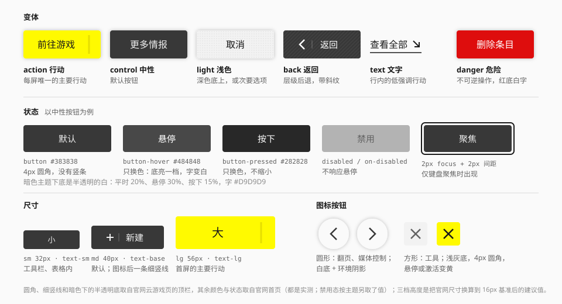

# 按钮

## 用途

触发一个行动。这套语言里按钮的特点：**实色、4px 的微圆角、图标和文字之间一条细竖线，悬停只换底色**。外形照的是官网云游戏页（`/cloud`）顶栏右侧的导航项（[实测](../references/measurements-cloud.md) 8.2）。库里原来照的是官网首页的通用按钮（左侧一条黄竖条，悬停时变成箭头），2026-10 改成了现在的样子。



## 变体

| 变体 | 外观 | 用在哪 | 来源 |
| --- | --- | --- | --- |
| `action` | 信号黄底、墨字、右侧一条深黄分隔线 | 每屏唯一的主要行动 | 实测（官网首页大按钮） |
| `control` | 深灰底、浅字；暗色主题下是半透明的白 | **默认。** 大多数按钮 | 实测（官网通用按钮）；暗色取云游戏页顶栏的深色导航项（实测（云游戏页）） |
| `light` | 浅灰底叠一层点阵、墨字 | 深色底上；或与 `control` 并排时的次要项 | 实测（云游戏页顶栏的亮色项）；点阵是推断 |
| `back` | 深灰底叠斜纹、左侧箭头 | 返回上一级 | 实测 |
| `text` | 无底、墨字、下划线、斜箭头 | 行内或列表末尾的低强调行动 | 推断 |
| `danger` | 红底白字 | 删除、不可逆操作 | 推断 |

### 关于"主要行动"

两个容易做错的地方：

- **黄色按钮一屏只有一个。** 官网只在首屏的核心入口用黄底；版块里的"更多情报""更多视频"都是深灰的 `control`。
- **最重要的按钮不一定是黄的。** 官网导航轨上的"前往游戏"是黑底白字，悬停才变黄。当页面已经有黄色的当前项、色带时，主要行动用墨黑反而更突出。

游戏界面另有一套：工具面上的主行动是**白色胶囊 + 圆形图标章**，次行动是深色胶囊（社区）。做游戏风格界面时可以把 `action` 与 `control` 的形状换成胶囊，颜色逻辑不变。这条在官方网页上也有了一个例子：云游戏页首屏的主行动是一对胶囊，左边 `#EEEEEE` 的"下载游戏"、右边 `#F2E200` 的"开始游戏"，各 188 × 48px、60px 圆角，黄的这颗是这一屏唯一的黄按钮——实测（云游戏页），见 [云游戏页](../surfaces/cloud.md#和规范不一致的地方)。默认的按钮不做胶囊，取的是同一页顶栏导航项的 4px 微圆角。

## 规格

| 项 | `sm` | `md` | `lg` |
| --- | --- | --- | --- |
| 高度 | 32px | 40px | 56px |
| 字号 | `text-sm` | `text-base` | `text-lg` |
| 字重 | Medium | Medium | Medium |
| 水平内边距（`control`、`light`、`danger`，左右对称） | 16px | 24px | 32px |
| 图标与文字之间的竖线 | 1 × 12px | 1 × 14px | 1 × 16px |
| 竖线两边的空 | 6px | 8px | 10px |
| 最小宽度 | 64px | 96px | 160px |

| 项 | 值 | 来源 |
| --- | --- | --- |
| 圆角 | 4px（`rounded-sm`），悬停时不变；`text` 变体没有 | 实测（云游戏页顶栏的导航项）。官网首页的通用按钮是 2px、悬停变 6px，大按钮 3px，返回按钮约 4px；云游戏页的按钮组件一律是 60px 圆角的胶囊（见 [云游戏页](../surfaces/cloud.md#和规范不一致的地方)），这里不取 |
| 阴影 | `shadow-xs`；`action` 用 `shadow-md` | 实测（首页）。云游戏页顶栏的导航项压在黑色的栏上，没有阴影 |
| 竖线 | 字色 30%，有 `iconStart` 时才有（`back` 默认的左箭头也算） | 实测（云游戏页的导航项是白 / 黑 20%）；30% 和 [主行动块](navigation.md#主行动块) 的那条一样 |
| 文字对齐 | 居中 | 实测 |
| 行高 | 1 | 实测 |

官网的按钮宽高比很大（通用按钮 20 × 4.5rem，约 4.4:1）。按钮宁可宽一些，不要把文字挤到贴边。

左右留白比云游戏页导航项的 12px 宽：那一排是顶栏里的工具钮，这里的按钮要能单独站在版面上。`action` 的留白左窄右宽（分隔线右侧留一条窄条），`back` 是 14 / 20 / 28px，都和原来一样。

云游戏页的按钮可以拿来对照：首屏和登录后账号卡上的按钮都出自同一个组件，七种变体（主要黄、次要灰、深色、警示红、浅色描边、灰色描边、弱警示）× 24 / 28 / 34 / 40 / 44px 五档高度。悬停和按下各是一个写定的色值——黄 `#F2E200` → `#F2E861` → `#918800`，灰 `#EEEEEE` → `#FAFAFA` → `#8F8F8F`——状态之间瞬切，没有过渡，也没有阴影。文字前面先是一根 1px 的细线，两端各一个 3px 的小方块：和这里图标后面的细竖线一样，是按钮自带的装饰记号。以上是实测（云游戏页），见 [云游戏页实测](../references/measurements-cloud.md) 8.3。形状是胶囊，这里不取；黄胶囊悬停会变浅，和官网首页"黄色按钮悬停时底色不变"不同，这里照首页。

## 状态

### `control`

| 状态 | 底（亮色主题） | 底（暗色主题） | 字 |
| --- | --- | --- | --- |
| 默认 | `button` `#383838` | 白 20% | `on-button`：亮色 `#EEEEEE`，暗色 `#D9D9D9` |
| 悬停 | `button-hover` `#484848` | 白 30% | 白 |
| 按下 | `button-pressed` `#282828` | 白 15% | 白 |
| 禁用 | `disabled` | `disabled` | `on-disabled` |
| 聚焦 | 同默认 | 同默认 | 外加焦点环 |

暗色主题下的半透明白照的是云游戏页顶栏的深色导航项（实测（云游戏页））：比下面的页面亮一档，压在哪一种暗色面上都分得出来，按下时比平时还淡一点——压在深色上，淡就是暗。字比官网的 `#BFBFBF` 亮一档，压在 `surface-muted` 上也有 5.5:1，见 [色彩](../foundations/color.md#亮色与暗色)。

### `action`

| 状态 | 底 | 字 | 分隔线 |
| --- | --- | --- | --- |
| 默认 | `action` `#FFFA00` | `on-action` `#191919` | `#FFF500` |
| 悬停 | 不变 | 不变 | `#EFE701` |
| 按下 | `action-pressed` `#EEEA00` | 不变 | `#E6DE01` |
| 禁用 | `disabled` | `on-disabled` | `on-disabled` 20% |

黄色按钮悬停时底色**不变**，只有分隔线加深（实测）。黄已经是最亮的颜色，再变亮没有意义，变暗又像是被按下。

实现里分隔线不写死这三个黄：用 `on-action` 以 10% → 15% → 20% 的不透明度叠在底色上。在信号黄上的结果约为 `#E8E303` → `#DDD804` → `#D1CD05`，比实测的三档略深一点，换来的是主题色接管时分隔线自动跟着变。

### `light`

浅灰底墨字，底上叠一层很淡的点阵（墨色 8%，4px 一格）；悬停变浅，按下变深一档。

| 状态 | 底 | 字 |
| --- | --- | --- |
| 默认 | `neutral-100` `#F2F2F2` + 点阵 | `neutral-900` |
| 悬停 | `neutral-50` `#FAFAFA` + 点阵 | 不变 |
| 按下 | `neutral-200` `#E6E6E6` + 点阵 | 不变 |

云游戏页顶栏的亮色项是 `#EEEEEE`、悬停 `#FAFAFA`、按下 `#8F8F8F`（实测（云游戏页））。底取中性阶里最近的一级；按下没有照抄那一下猛然变暗，只深一档，和别的变体一致。

顶栏里唯一的亮色项"下载"是它的近亲：`#EEEEEE` 底叠一张浅灰细斜纹、墨字；左缘外面隔 3px 一根 4 × 36px 的竖条，从上往下由品牌黄 `#FFF100` 渐变到白；悬停时整块变品牌黄——实测（云游戏页），见 [云游戏页](../surfaces/cloud.md#顶栏)。这里只取了浅灰底和一层表面纹理：那张纹理是官方的图，不收录，换成库里原创的点阵（见 [纹理](../foundations/texture.md#表面纹理图)）；外侧的黄竖条和"悬停变黄"没有带过来——`light` 常常是弹窗里的"取消"，带上就比旁边的"确认"还显眼。

它在亮、暗两个主题下**是同一个浅灰**，不跟着 `surface` 翻转——这个变体本来就是给深色底用的。

### `danger`

红底白字：`alert-fill`（`#DE0909`），悬停 `#C40808`，按下 `#A80707`，白字 5.1:1 起。两个主题下是同一个红：暗色主题的 `danger` 是按文字调的 `#F74040`，作底配白字只有 3.6:1。

它和 `control` 原来只差一条红竖条；竖条去掉以后，整块换成红色。一屏里红色按钮和黄色按钮一样少见：只给真的删除、不可逆的那一个。

### 禁用

官网的禁用按钮对比度很低（`#666666` 压 `#888888`，约 1.6:1），而且这个底色在暗色页面上比正常按钮还亮。实现改用按主题取值的 `disabled` / `on-disabled`（亮色 2.9:1，暗色 2.4:1），所有带底色的变体共用；`text` 变体的禁用是 `ink-disabled` 文字。

禁用态不要求达到正文对比度，但建议在旁边用文字说明不可用的原因。

### 高对比模式

（推断，见 [色彩](../foundations/color.md#高对比模式)）

底色被系统换成页面色之后，带底色的五种变体都只剩一行字：看不出它是按钮，也分不出是哪一种。`text` 靠下划线成形，不受影响。

- **外形是一圈 1px 的 `ButtonText` 线。** 只在高对比模式下补，平时的尺寸不动；4px 的圆角系统不改，线也是圆角的。不做成实心块：实心在这套对应里留给"选中"。
- **底色画的线改用 `ButtonText`**：图标和文字之间的细竖线（平时是字色 30%，这里写成不透明，不然淡到看不清）、`action` 右侧的分隔线。
- **悬停时字加一条下划线。** 底色的变化系统不画，悬停本来没有任何反馈；下划线不占用"选中"色（`Highlight`），换哪套系统配色都看得见。`text` 本来就有下划线，不另加；禁用的不加。
- **分得开的地方不多。** `action` 靠右侧的分隔线和其余几种分开；`control`、`light`、`danger` 只剩线和字，成了一个样——"危险"本来也要靠文字说。`back` 的斜纹系统不画，剩左边的箭头。只有一圈线的话，按钮和输入框、步进器的格子是同一种方框，按钮上的字要写成动词。
- **禁用**：线、字、竖线都是 `GrayText`。真的 `disabled` 的 `<button>`，字色系统自己会换；链接形态禁用时是一个去掉了地址的 `<a>`，系统把它当普通字，所以字色也写明。
- **加载中**：线和字照旧——它不是禁用，平时也不变灰。旋转方块用 `ButtonText`，和按钮上的字一个颜色。
- **链接形态**的字是系统的链接色（`LinkText`），不去改它；线照旧是 `ButtonText`。

## 悬停动效

只换色：底色和字色一起过渡，`--duration-fast`、`ease-standard`。圆角、尺寸、阴影都不变，不上浮、不放大。云游戏页顶栏的按钮是 0.15s，这里用库里颜色变化统一的那一档 200ms。

- 套在 `@media (hover: hover)` 里，触屏上不触发（Tailwind v4 的 `hover:` 默认如此）。
- 唯一还会动的记号是 `text` 变体的斜箭头：悬停时往右下挪 2px。
- 官网首页通用按钮的"竖条变箭头"已经不用，做法留在 [动效](../foundations/motion.md) 里，工具类 `marker-bar` / `marker-arrow` 照旧公开。

## 图标按钮

| 形态 | 变体名 | 外观 | 用在哪 | 来源 |
| --- | --- | --- | --- | --- |
| 圆形 | `floating` | 白底（`neutral-50`，两个主题下都是白的）、`shadow-sm`、墨色图标 | 翻页、媒体控制、浮在图像上的操作 | 实测 |
| 方形 | `plain` | 浅灰底（`surface-sunken`）、中灰图标、4px 圆角 | 工具栏、顶栏 | 实测 |
| 方形强调 | `accent` | 悬停或激活时变信号黄 | 分页条两端的翻页钮 | 悬停变黄：实测；官网的翻页钮是圆的，方形是这里的画法 |
| 方形反转 | `inverse` | 悬停或激活时变墨底、图标变黄；它打开的菜单、展开条开着的时候也保持这个样子 | 分享、开关类工具 | 实测 |

`inverse` 在暗色主题下反过来：底变近白（`surface-inverse`），图标用 `accent-ink-inverse`——黄色图标压在白底上是看不见的。

三种方形的都是 4px 圆角，和按钮同一档（官网移动端顶栏的图标钮也是 4px，实测）；`floating` 是圆。

| 项 | `sm` | `md` | `lg` |
| --- | --- | --- | --- |
| 尺寸 | 32px | 40px | 48px |
| 图标（只有图标时；旁边有字时都是 16px） | 16px | 20px | 24px |

- 圆形按钮成对出现（上一个 / 下一个）时，可以包在一个浅灰或近黑的胶囊里。
- 关闭按钮在悬停时旋转 90°（实测）。
- **高对比模式**下底色被系统换掉：没激活的只剩一个图标，看不出是按钮；激活的和没激活的也成了一个样子。没激活的补一圈 1px 的 `ButtonText` 线（`floating` 是圆圈），禁用的是 `GrayText` 的线；激活（`pressed`）的整块改用系统的"选中"色——`Highlight` 底和线、`HighlightText` 图标。四种变体都一样。那一圈线三种状态都在，换状态时图标不挪；32px 那一档往外补的点击区跟着多补 1px，还是 40px。见 [色彩](../foundations/color.md#高对比模式)。（推断）
- 必须有 `aria-label`。

## 按钮组

- 并排的按钮之间留 8 – 12px。
- 主要行动放在最右（或最下）。
- 一组里最多一个 `action`。
- "取消 + 确认"用 `light` + `control`，而不是"灰 + 黄"——把黄色留给真正重要的时刻。
- 一白一黄的并列按钮对（如"×1 / ×10"）来自游戏内的抽取界面（社区），现在有了实测（云游戏页首屏）：左边 `#EEEEEE` 的"下载游戏"、右边 `#F2E200` 的"开始游戏"，一样大，各 188 × 48px、60px 圆角，黄的在右。只在两个选项同等重要、且确实是页面核心行动时使用；形状仍是按钮一族的 4px 微圆角，不做胶囊。

已实现为 `<ButtonGroup align orientation gap>`：

- 默认横排、靠右（`align="end"`），间距 12px；`gap="sm"` 是 8px。主要行动写在最后一个；
- `align="between"` 把两端的按钮分到两边，用在"上一步 / 下一步"；
- `orientation="vertical"` 竖排：按钮拉到等宽，主要行动在最下，用在窄栏和移动端的底部；
- 放不下时整组换行，不挤压按钮——按钮宁可掉到下一行，也不把文字挤到贴边；
- 语义是一个分组（`role="group"`），用 `aria-label` 说明这组按钮管的是什么；
- "一组里最多一个 `action`"组件不拦，靠使用方自己守。

## 工具栏

（推断：从上面的图标按钮延伸。方形图标钮本来就是"工具栏、顶栏"用的，"开关类工具"激活时是墨底黄图标——这两条是实测；把一排收进一条带子、Tab 只停一次，是这里加的）

一排作用于同一个对象的小工具：表格上面的密度、展开、导出；编辑器上面的对齐、加粗。

| 项 | `sm` | `md`（默认） |
| --- | --- | --- |
| 带子的高 | 32px | 40px |
| 里面的钮 | 28px | 36px |
| 图标 | 16px | 20px |
| 钮之间 | 2px | 2px |

带子和输入框、[分段选择](form.md#分段选择) 同高，并排时对得齐。

| 状态 | 画法 |
| --- | --- |
| 带子 | `surface-sunken` 底，直角，四周 2px 内边距。`variant="outline"` 换成 1px `line-strong` 描边 + `surface` 底，放在凹陷底色的区域里用 |
| 钮，平时 | 透明底，`ink-secondary` |
| 悬停 | `ink` + `ink` 叠 5% 的底；按下叠 10% |
| 开关钮按下、菜单还开着 | `surface-inverse` 底；图标是 `accent-ink-inverse`（墨底黄记号，和 `inverse` 图标钮同一个样子），字是 `ink-inverse`（和分段选择选中的那一段一样——黄色留给记号，不拿来写字） |
| 禁用 | `ink-disabled`；按下又禁用是 `disabled` 底 + `on-disabled` |
| 分隔 | 1px `line-strong`、高 16px 的竖线，两边各留 4px |

已实现为 `Toolbar` 和它的几个部件：

```tsx
<Toolbar aria-label="表格工具">
  <ToolbarToggleGroup aria-label="行高" value={density} onValueChange={setDensity}>
    <ToolbarToggle value="md">标准</ToolbarToggle>
    <ToolbarToggle value="sm">紧凑</ToolbarToggle>
  </ToolbarToggleGroup>
  <ToolbarSeparator />
  <ToolbarToggle icon={<RuleIcon />} aria-label="每五行加重" pressed={ruled} onPressedChange={setRuled} />
  <ToolbarButton icon={<PrintIcon />} onClick={print}>
    打印
  </ToolbarButton>
</Toolbar>
```

| 部件 | 属性 |
| --- | --- |
| `Toolbar` | `aria-label`（必填）、`size`、`variant`、`orientation`、`disabled` |
| `ToolbarButton` | `icon`、`disabled`；传 `href` / `render` 就是链接。只有图标时必须有 `aria-label` |
| `ToolbarToggle` | `pressed` / `defaultPressed` / `onPressedChange`；在开关组里用 `value` |
| `ToolbarToggleGroup` | `value` / `defaultValue` / `onValueChange`（数组）、`multiple`、`aria-label` |
| `ToolbarGroup` | `aria-label`：几个钮在读屏里算一组 |
| `ToolbarSeparator` | — |

- **整条工具栏只占一个 Tab 停靠点**（`role="toolbar"`）：Tab 进来落在上次停的那一个上，`←` `→` 在各项之间走，`Home` / `End` 到两头，走到头绕回去。竖排（`orientation="vertical"`）时换成 `↑` `↓`。
- **禁用的钮仍然走得到**：读屏读得出它在那儿、现在不可用。它不响应点击。
- **开关组默认同时只能按下一个，而且可以一个都不按**；`multiple` 可以同时按下几个。值都是数组。要"必须选一个"的，是表单里的 [分段选择](form.md#分段选择)，不是这个。
- **和浮层一起用**：把 `ToolbarButton` 交给 `Menu` / `Popover` 的 `trigger`，或者用 `Tooltip` 包住它。打开着的时候那个钮保持按下的样子。
- **高对比模式**下底色都被系统换掉，按下的开关钮和没按的成了一个样子：按下的改用系统的"选中"色（`Highlight` 底，字和图标都是 `HighlightText`），按下又禁用的是 `GrayText` 底、`Canvas` 字。菜单还开着的那个钮没有另画：开着的菜单自己就在眼前。见 [色彩](../foundations/color.md#高对比模式)。（推断）
- **高对比模式**下凹陷的底也没了，带子就不见了，一排钮散在页面上：带子补一圈 1px 的 `ButtonText` 线，画在内边距里，不占地方（描边的那种本来就有线，只把颜色写明）。里面没按下的钮不另画框——它们平时就是透明的，靠带子围着，丢的是带子。分隔线是底色画的，改用 `ButtonText`。禁用的钮还走得到，不是真的 `disabled`，系统不会替它把字换灰：字色写明 `GrayText`；整条禁用时带子的线和分隔线也是 `GrayText`。（推断）
- 放不下时换行，不出横向滚动条。
- 32px 那一档的钮只有 28px 宽，是给有鼠标的密集界面用的；触屏上用 `md`（点击区补到了 40 × 40px）。
- **不在工具栏里放输入框**：`←` `→` 在输入框里是移光标，和工具栏的走法冲突。搜索框放在工具栏外面。

### 用哪个

| 要的是 | 用 |
| --- | --- |
| 两三个有主次的行动（取消 / 确认） | 按钮组 |
| 一排对同一个对象的小工具，有的是开关 | 工具栏 |
| 表单里从几项选一个值，要随表单提交 | [分段选择](form.md#分段选择) |
| 几个能各自开关的筛选条件 | [筛选胶囊](data-display.md) |
| 切换下面显示的内容 | [页签](navigation.md#页签) |

## 内容

- 文字 2 – 6 个汉字。动词开头："查看全部""前往游戏"。
- 不要在按钮里放两行文字。
- 图标在文字左侧；表示"前往"的箭头在右侧。
- 加载中：文字换成"处理中"并显示一个小的加载指示，按钮宽度不变，禁止重复点击。实现里加载指示是一个旋转的小方块，占一个已经有的位置，所以不会挤动文字：有图标时换掉图标（`back` 的箭头也是）；`control`、`light`、`danger` 没有图标时放在左侧留白的正中；`action` 在分隔线右侧的窄条里，图标照旧；`text` 换掉末尾的斜箭头。

## 无障碍

- 用 `<button>`；跳转用 `<a>`：传 `href` 就渲染成链接。用路由库时把它的链接组件传给 `render`，写法和禁用时的差别见 [通用约定](README.md#链接与路由)。
- 禁用用 `disabled` 属性；需要在禁用时仍可聚焦以读出原因时，用 `aria-disabled="true"`。
- 细竖线、分隔线、箭头、纹理都是装饰（`aria-hidden`）。
- 焦点环：`focus-visible:outline-2 outline-offset-2 outline-focus`。

## 宜 / 忌

**宜**

- 默认用 `control`。
- 让按钮足够宽。
- 用位置和大小表达主次，再用颜色。

**忌**

- 一屏多个黄色按钮；红色按钮也一样，只给真的删除。
- 大圆角、胶囊按钮（游戏风格界面除外，见上文），渐变按钮，发光按钮。按钮一族只有 4px 这一档；云游戏页的按钮组件一律是胶囊（见 [云游戏页](../surfaces/cloud.md#和规范不一致的地方)），这里不取。
- 悬停时上浮、放大或改变圆角。
- 给所有按钮切角。
- 用 `text` 变体做页面的主要行动。

## 来源

- 圆角、细竖线、暗色下的半透明底、亮色项：[measurements-cloud.md](../references/measurements-cloud.md) 第 8.2 节（云游戏页顶栏右侧的导航项，含"下载"）。
- 尺寸、其余颜色与状态：[measurements.md](../references/measurements.md) 第 8.3 – 8.6 节（官网首页）。
- 游戏界面的胶囊行动：[Statrue/endfield-design-skill](https://github.com/Statrue/endfield-design-skill)。
- 云游戏页的胶囊按钮：[measurements-cloud.md](../references/measurements-cloud.md) 第 8.3 节；和规范的对照见 [云游戏页](../surfaces/cloud.md#和规范不一致的地方)。
