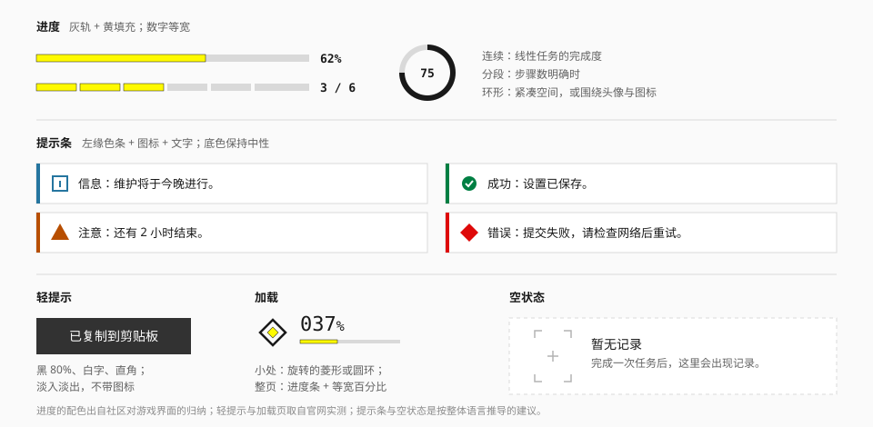

# 反馈

## 用途

告诉用户"发生了什么、进行到哪了"：进度、提示、加载、空状态。

## 实现状态

| 控件 | 写法 | 状态 |
| --- | --- | --- |
| 进度条 | `<Progress value max size showValue animate>` | 已实现 |
| 分段进度 | `<Progress segments={6} value={3}>` | 已实现 |
| 不确定进度 | `<Progress>`（不传 `value`） | 已实现 |
| 提示条 | `<Alert tone title action onClose open>` | 已实现 |
| 骨架 | `<Skeleton variant lines pulse>` | 已实现 |
| 空状态 | `<EmptyState title description action>` | 已实现 |
| 按钮提交中 | `<Button loading>`，见 [按钮](button.md) | 已实现 |
| 行内加载 | `<Spinner size label>` | 已实现 |
| 进度环 | `<ProgressRing value size showValue>` | 已实现 |
| 轻提示 | `<ToastProvider placement duration>` 包住应用，里面用 `useToast()`：`toast("已保存")` | 已实现 |
| 加载页 | `<Loader value tagline open>` | 已实现 |
| 开屏页 | `<SplashScreen value logo tagline open>` | 已实现 |
| 完成横幅 | `<CompletionBanner title word description action>` | 已实现 |
| 列表行的完成态 | `<ListRow completed>`，见 [卡片](card.md) | 已实现 |

## 进度

**灰轨 + 黄填充。** 游戏内的任务、经验、通行证进度条都是这个组合（社区）。

### 进度条

| 项 | 值 | 来源 |
| --- | --- | --- |
| 轨道 | `line`（亮）/ `control`（暗），直角 | 社区 |
| 填充 | `action` | 社区 |
| 高度 | 4px（细）/ 8px（标准） | 推断 |
| 数值 | 条的右侧或上方，`font-tech`，等宽，加粗 | 实测（加载页）|
| 入场 | 从左充填：`animate-fill`，`transform-origin: left` | 实测 |

亮色表面上，黄色填充和浅灰轨道之间的对比度偏低。两种补救（推断）：

- 给填充加一条 0.5 – 1px 的墨色描边；
- 或者亮色主题下把填充换成 `ink`（墨色），只在完成时变黄。

实现**两种都没用**：填充就是纯色的 `action`，没有描边。

- 试过第一种（填充四周 1px 的墨色描边）。对比度是够了，但亮色界面上一圈黑框显得重，和"反馈保持安静"相悖，所以去掉了。
- 代价是亮色主题下填充对轨道只有 1.3:1，靠的是色相差（黄对中性灰）而不是明度差。进度的确切数值不要只靠这根条表达：需要读数时打开 `showValue`，或者在旁边写出来。
- 轨道统一用 `line`：它在暗色主题下的取值（`#383838`）正好等于上表要的 `control`。
- 数值在条的右侧，留出"100%"的宽度：几条并排、位数不同时，轨道仍然对齐。
- **高对比模式**下轨道和填充都是底色画的，整根条会不见：轨道剩一圈 1px 的 `CanvasText` 线（空心），填充是 `Highlight` 的实心条——实心对空心，不靠两种系统色分。不确定进度那一块、加载页的进度条同理。见 [色彩](../foundations/color.md#高对比模式)。（推断）

**进度归黄，量值归蓝。** 表示"完成了多少"用这里的进度条；表示"数量有多少"用图表，颜色是 `data` 蓝。

### 分段进度

步骤数明确时（`3 / 6`），把轨道切成等长的小段，段间留 4px。已完成的段是黄色，未完成的是灰色。高对比模式下已完成的段是 `Highlight` 的实心块，未完成的各自一圈 `CanvasText` 线（推断）。

官网世界观版块的"一排短横、当前一根为黄"是它的指示器版本（实测），见 [导航](navigation.md)。

每一步有名字、要让人看见后面还有哪几步时，用 [步骤条](navigation.md#步骤条)。

### 进度环

| 项 | 值 |
| --- | --- |
| 轨道 | 细圆环，`line` |
| 填充 | 从 12 点方向顺时针；`ink` 或 `action` |
| 线宽 | 直径的 8 – 10% |
| 中心 | 数值（不带 `%`）或图标 |

用在紧凑空间，或者围住一个头像、图标。游戏内的技能冷却用的就是弧线（社区）。

已实现为 `<ProgressRing value max size showValue>`：

- `size` 是直径的像素值，默认 48；线宽取直径的 9%，最细 2px，也可以用 `thickness` 指定；
- 填充和进度条一样是纯色的 `action`、不描边，轨道是 `line`；亮色下的对比同样偏低，需要读数时打开 `showValue`（中心显示不带 `%` 的百分比）；
- 中心也可以放图标或头像（作为子元素传入），这时不显示数值；
- 不传 `value` 是不确定进度：四分之一圈的弧匀速旋转。系统开启"减少动态效果"时换成**一圈虚线**——静止的一段弧会被看成"进度 25%"。
- **高对比模式**：环是 SVG 画的，上面写的颜色系统不换——轨道和弧还是主题里的浅灰和黄，压在使用者自己定的页面色上可能看不清（白底上的黄）。所以自己写成系统色：轨道收成一圈 1px 的 `CanvasText` 细线，弧是 `Highlight`、照旧是原来的线宽。细对粗，和进度条的"空心对实心"是一个意思。见 [色彩](../foundations/color.md#高对比模式)。（推断）

### 不确定进度

不知道总量时：

- 条形：一段固定长度的黄色块在轨道上匀速往返；
- 小处：旋转的菱形或圆环（`animate-spin`）。

条形的实现：色块宽为轨道的 40%，用 `animate-indeterminate` 往返（1.2 秒一程）。系统开启"减少动态效果"时色块停在轨道正中——停在左端会被看成"进度 40%"。

## 提示条

页面内的一条常驻消息。

| 项 | 值 |
| --- | --- |
| 底 | `surface-raised`，不描边 |
| 左缘 | 4px 语义色条 |
| 图标 | 语义色，16 – 20px |
| 文字 | `ink`，`text-sm` |
| 圆角 | 0 |
| 操作 | 右侧可放一个 `text` 按钮或关闭图标 |

**不围外框**（实现时改的）。它靠底色的差分和左缘的色条成形：围一圈线是"卡片"的画法，而卡片在这套语言里用得很克制，一条页面内的消息不该看起来像一个盒子。左缘那一条色条是有含义的——它是提示条的记号，和列表行左缘的强调竖条是同一个东西。

| 色调 | 色条与图标 | 图标形状 |
| --- | --- | --- |
| `info` | `info` | 方框 |
| `success` | `success` | 圆 + 对勾 |
| `warning` | `warning` | 三角 |
| `danger` | `danger` | 菱形 |

四种色调用**四种不同形状**的图标，不只靠颜色区分。

底色保持中性，不做成整块的浅红、浅绿。理由和整套语言一致：颜色是信号，点到为止。

危险操作的确认区可以在顶边加一条 [警示条纹](../elements/stripes-and-strips.md)。

这一节是推断；官网没有对应的组件。

实现：

- 色条与图标用文字档的语义色（`info`、`success`、`warning`、`danger`），它们已经按主题切好。
- 四个图标是原创的 `StatusInfo`、`StatusSuccess`、`StatusWarning`、`StatusDanger`，外形依次是方框、圆、三角、菱形；输入框的错误图标用的也是这个菱形。
- 有标题时标题加粗、正文降为 `ink-secondary`；没有标题时正文就是 `ink`。
- 提示条自己不隐藏：`onClose` 只负责通知，显示与否由使用方决定。
- **要收起的过程，把 `open` 交给它**（受控，默认 `true`，写法同加载页）：置为 `false` 时先收起高度、淡出（`--duration-fast`），再从页面里拿掉，收完触发 `onExited`。直接不渲染它（`{open && <Alert />}`）照旧能用，只是立刻消失。（推断，见 [动效](../foundations/motion.md#展开与增删)）
  - 收的不只是高度：它自己的外边距、它在纵向排的父容器里占的那个行间距一起收，卸载的那一刻后面的内容不会再跳一下。
  - 收起途中点不到、`Tab` 不进去；焦点原来在关闭钮上的，收起一开始就离开了——关掉之后焦点该去哪由使用方定（在 `onClose` 里移过去）。
  - 只做了关闭。再显示出来是直接出现的。

## 轻提示

短暂浮现的一句话（实测）。

| 项 | 值 |
| --- | --- |
| 底 | 黑 80%，不描边；暗色页面上补一圈环境阴影（`shadow-sm`） |
| 文字 | 白，16px，行高 1.4 |
| 圆角 | 0（官网是 0.25em，约 4px 的微圆角；这里取直角） |
| 位置 | 视口正中（官网）；或底部居中 |
| 动效 | 透明度淡入淡出（实测）。底部的那一种另从下面升上来 8px（推断） |
| 内边距 | 垂直 10 – 12px，水平 20 – 24px |

官网的轻提示非常朴素：没有图标、没有颜色、没有关闭按钮。

需要区分成功与失败时，在文字前加一个小的语义色图形（◆ / ●），不要把整块底色换掉。

- 停留 2 – 4 秒；有操作按钮时延长，并允许手动关闭。
- 同时只显示一条，新的替换旧的。
- 重要的、需要用户处理的信息不要用轻提示，用提示条或弹窗。

实现：

- 写法是命令式的：`const toast = useToast()`，然后 `toast("已保存")`，或者 `toast({ message, tone, action, duration })`。返回这一条的 id，`toast.dismiss(id)` 关掉它。
- 默认出现在视口底部居中，离底边 24px；`placement="center"` 是官网的视口正中。
- 默认停留 3 秒。指针停在上面、或者焦点在里面的时候不计时。
- **新的替换旧的**：弹出一条时把还在的那条关掉，两条在同一个位置交替：旧的原地淡出，新的进来。
- **底部的从下面来**（推断，见 [动效](../foundations/motion.md#方向位移)）：进场时淡入（`--duration-fast`），同时从下面升上来 8px（`--duration-base`、`ease-exit`）——它贴着视口的底边出来，位移用大的那一档。退场只淡出。`placement="center"` 是官网的做法，只有透明度，不加位移：正中没有"从哪来"。
- `tone` 只在文字前加一个 16px 的语义色图标，和提示条一样用四种不同的外形；底色不变。
- 带 `action` 时多停一会儿（默认 8 秒），并出现关闭图标；点了操作之后这一条随即关掉。`duration: 0` 是一直留着，同样带关闭图标。
- **黑底白字不随主题变。** 整条是一个 `data-theme="dark"` 的局部主题，图标、操作、焦点环都按深色底取值。它不围外框：暗色页面上 80% 的黑和页面几乎一样深，靠一圈零偏移的环境阴影（`shadow-sm`，浮层共用的那一条）把它和页面的分出来——比一条 1px 的线更符合"阴影是环境光"的画法。
- 读屏：提示区域是一个有名称的区域（默认"通知"），按 `F6` 可以把焦点移进去。普通的提示排队播报；`warning` 与 `danger` 会打断当前在读的内容。
- 可以往下或往右划走。划的时候提示贴着手指：居中和手势的位移写在 `transform` 上，基元拖动时用内联的 `transform` 接管它。（不能写在 `translate` 上——两个属性会叠加，提示走成手指的两倍。）拖的时候不选中里面的文字：用鼠标拖会把字选上，下一次再拖，浏览器当成"拖这段字"，手势就被取消了。没划够就松手，提示滑回原位（`--duration-fast`）；拖动中没有过渡——进场的位移写在 `translate` 上，和跟手的 `transform` 是两个属性。
- 层叠值是 `--z-toast`，在所有浮层之上、加载页之下。

## 加载

| 场景 | 做法 |
| --- | --- |
| 整页首次加载 | 加载页：近黑底、黄色进度条、等宽大号百分比、一行标语。见 [动效](../foundations/motion.md) |
| 整页首次加载，要带标志、要官网那一套排场 | [开屏页](#开屏页)：贴边的进度条、跟着条走的读数、标志、微标与标语；就绪后黄色铺满整屏再淡出 |
| 区块内容加载 | 骨架：与内容等大的 `surface-muted` 色块；不闪烁，或只做很轻的明度往返 |
| 按钮提交中 | 按钮内的小型旋转指示，按钮宽度不变 |
| 行内 | 12 – 16px 的旋转菱形或圆环 |

加载页的规格（实测）：

| 项 | 值 |
| --- | --- |
| 底 | `#141414` |
| 进度条 | `#FFFA00`，圆角 0.25rem，`scaleX` 从 0 到 1 |
| 百分比 | 数字 4.375rem Medium，`%` 3.25rem Regular |
| 标语 | 1.5rem Regular |

规则：

- 保持布局稳定：加载前后内容区的尺寸不变。
- 不伪造进度。不知道真实进度就用不确定进度。
- 内容就绪后立即显示，不为了播完动画而等待。开屏页是唯一的例外：它的退场是照官网走的，要 2.4 秒，见 [开屏页](#开屏页)。
- 骨架屏只画大块，不画细节。

加载页已实现为 `<Loader value tagline open>`：

- **固定的近黑底**，不随主题变：`neutral-950` 底、`neutral-0` 字、`neutral-800` 轨道、`action` 进度条。字号直接落在字阶上：数字 `text-5xl`、`%` `text-4xl`、标语 `text-xl`——把上表实测的 rem 值按 16px 一个 rem 算，两边只差 2px 以内；容器很窄时各降一到两档。
- 内容靠左下角：数字 → 标语 → 进度条。进度条高 6px、圆角 4px，用 `scaleX` 充填。
- `value` 是真实进度（0 – 100）。不知道进度就不传：进度条换成往返的色块，**不显示数字**——不伪造进度。
- 大号数字只是给眼睛看的；读屏拿到的是进度条的 `aria-valuenow`，名称默认"加载中"。
- 内容就绪后把 `open` 置为 `false`：遮罩**立刻**开始向上滑出（600ms），不等进度条走完；滑出结束后卸载，并触发 `onExited`。等的是遮罩自己的那次过渡；没有过渡可等的环境里（测试环境）当场卸载。"充满后停留片刻"这一步没有做成内置的延时，理由同上面的第三条规则。
- 默认铺满视口（`fullscreen`），加载期间锁住页面滚动、把焦点收进来并拦住 `Tab`；开始退出的那一刻就全部放开，滑出中的遮罩不挡点击。关掉 `fullscreen` 则铺满所在的定位容器，不碰页面。
- 层叠值是 `--z-loader`，全库最高，见 [布局](../foundations/layout.md) 的"层叠顺序"。

### 开屏页

官网首次载入时的那一页，照 2026-10-14 的实测排的（数值见 [measurements.md](../references/measurements.md) 8.13）。加载页是它的简化版：只要一块盖住整页的等待，用 `<Loader>`；要带着标志开场、要那段"黄色铺满再揭开"的退场，用它。

已实现为 `<SplashScreen value logo tagline caption decor status backdrop open>`：

- **排法（横排）。** 一根贴左缘的黄色进度条，从上往下长；读数骑在条的末端上——上面是一颗小竖条和大号的数字，下面是两个小方块和一行状态字。画面偏右（左起 64.45%）是标志，下面一组微标、一条两头渐隐的分隔线和一行标语。
- **排法（竖排）。** 条横在靠下的位置，从左往右长，读数在它末端的右边；标志水平居中，微标组和标语靠左下。没有三角标，也不显示微文字——那里紧挨着读数，放不下。
- **横竖看它所在的那一块自己的宽高比**（容器查询），不看视口：关掉 `fullscreen` 放进一个竖着的框里，就是竖排。
- **尺寸跟着那一块的宽度等比缩放。** 一个单位是官网的 1rem：横排是宽度的 1/160，竖排是 1/67.5。16:9 下各部分的位置和官网逐像素对齐。纵向位置也和官网一样按宽度定（标志在上 27.625 个单位，微标组的底边在 63.375），所以别的宽高比下"标志 + 微标组"那一列不在正中：比 16:9 高的时候偏上，扁的时候偏下。只有一处没有照搬——官网在超宽的屏上这一列会掉出底边，这里放不下时往上收，标语的底边至少离底 4 个单位。竖排的标志同理：中心在上 50 个单位处，接近方形时不低于高度的 41.67%（再低会压到进度条）。
- **状态字和标语有字号的下限**（12px）。官网在小屏上会把它们缩到看不清，这一点也没有照搬；标语放不下就折行。竖排时下面那一摞是从底边往上排的，条按字多占的高度往上让。
- **不带任何图。** 标志（`logo`）和底图（`backdrop`）是插槽，放使用方自己的；它们可以用 `--ef-splash-unit` 跟着缩放。底图随进度从模糊（8px）变清晰。微标是代码画的一组（带框的加号、`caption` 的微文字、两排方点，旁边一枚三角标），`decor` 可以整组换掉，传 `null` 是不要。微文字写真事，不照抄官方的那两行，见 [镂空字与微文字](../elements/ghost-and-micro-text.md)。
- **固定的近黑底**，不随主题变：它是一块局部的暗色主题，插槽里照常用语义令牌。状态字用 `ink-tertiary`（官网的 `#666` 压在近黑底上只有 3:1）。
- `value` 是真实进度（0 – 100）。不知道进度就不传：条上换成一块往返的色块，**不显示数字**。
- **进度每变一次，条长、读数的位置、读数的数字、底图的模糊一起补间 0.5 秒**，读数显示的就是补间中的值。载入时就有的值不播。
- 读数只是给眼睛看的；读屏拿到的是进度条的 `aria-valuenow`，名称默认"加载中"。微标和底图是氛围，对读屏隐藏。
- 内容就绪后把 `open` 置为 `false`，退场是三段，一共 2.4 秒：**走满**（条用 0.5 秒走到头，读屏那边立刻报 100）→ **铺满**（黄色从左往右盖过整屏，0.6 秒，先慢后快）→ **淡出**（停到第 1.4 秒，整层用 1 秒淡掉）。淡出结束后卸载，并触发 `onExited`。
- **页面到开始淡出才放开。** 默认铺满视口（`fullscreen`），锁住页面滚动、把焦点收进来并拦住 `Tab`。和加载页不一样，开始退场时不放开——黄色盖着的那一段页面还完全看不见，放开了只会点到看不见的东西。到淡出真的开始的那一刻（第 1.4 秒）才全部放开，同时触发 `onReveal`：页面自己的入场从这里起（官网也是这时起的）。淡出中的那一层不挡点击。
- 系统开了"减少动态效果"、或者环境里没有动效可等（测试环境）时不走这三段：当场卸载，`onReveal`、`onExited` 先后各一次。
- **高对比模式**下条按进度条的写法：轨道一圈 `CanvasText` 的线，走过的一段是 `Highlight`；底图和微标不显示。
- 层叠值是 `--z-loader`，和加载页同一层。

带官方标志、底图和微标的那一版在 Game 入口，是另一个组件：[官网开屏页](../game/splash-screen.md)。

行内加载已实现为 `<Spinner size label>`：

- 一个匀速旋转的小方块（`animate-spin`），12px 或 16px，颜色继承所在位置的文字；按钮提交中用的就是它；
- 默认是一个状态区（`role="status"`），读屏听到"加载中"，这句话可以换；旁边已经写了"正在同步"之类的字时传 `label={null}`，方块变成纯装饰；
- 系统开启"减少动态效果"时方块停成一个 45° 的菱形，和列表里的菱形记号是同一个样子；
- 圆环形的不另做：用 16px 的进度环 `<ProgressRing size={16} />`。
- **高对比模式**下方块是底色画的（拿文字色当底色，系统照样把它换成页面色），会不见，"正在加载"就没了：改用 `CanvasText`。写的是系统色，不是跟着所在位置的字色——使用方用 `className` 给它另上了颜色时也照样看得见。要它跟着所在的控件走，由那个控件另写：[按钮](button.md#高对比模式) 里占着记号位的方块写成了 `ButtonText`，禁用时是 `GrayText`。见 [色彩](../foundations/color.md#高对比模式)。（推断）

骨架的实现：

- 色块用 `surface-muted`，不用最初设想的 `surface-sunken`：后者在亮色的面板（`surface-raised`）上几乎看不见，在暗色主题下是纯黑，会像一个洞。
- 三种形状：`block`（尺寸由使用方给）、`text`（几行，行高跟随所在位置的字号，末行短一截）、`circle`。
- 默认静止；`pulse` 打开后用 `animate-pulse` 做不透明度 1 ↔ 0.6 的往返，不做扫光。
- 骨架自身对辅助技术隐藏，"正在加载"由外层区域的 `aria-busy="true"` 表达。
- **高对比模式**下色块的底色被系统换掉，整片骨架是空白的，"正在加载"和"什么都没有"分不开：每个色块剩一圈 1px 的 `GrayText` 轮廓。用灰字色不用页面的字色——它和输入框里的占位字是一类东西（这里的内容还没到），而一圈字色的方框容易被看成输入框。见 [色彩](../foundations/color.md#高对比模式)。（推断）

## 空状态

没有内容时的占位（推断）。

| 部件 | 做法 |
| --- | --- |
| 容器 | 虚线描边（`line-strong`，4px 间隔），或无边框 |
| 图形 | 取景角 + 准星；或一个简单的等距线稿 |
| 标题 | 一句话说明现状："暂无记录" |
| 说明 | 一句话说明原因或下一步："完成一次任务后，这里会出现记录。" |
| 行动 | 可选的一个 `control` 按钮 |

游戏内图鉴用准星占位符表示"未获得"（社区），空状态沿用这个符号。

- 说明为什么为空、接下来能做什么。
- 搜索无结果、筛选无结果、出错、无权限是不同的空状态，文案分开写。
- 不要用大幅插画填满空白。

实现：默认图形是一个 56px 的原创线稿——四个取景角加中心的准星，`ink-tertiary`、1.5px 线宽；可以替换或去掉。虚线描边用浏览器的 `dashed`，间隔由浏览器决定，不保证正好 4px。放进面板里时把描边关掉，避免框套框。

入场（推断）：挂上的时候整块淡入一次，300ms，不加位移——只是为了不"啪"地一下出现。筛选之后没有结果、列表清空，都是它出现的时候。不等进视口：它要管的就是挂上的那一刻。`animate={false}` 关掉。

## 完成与庆祝

游戏内的任务完成态是一次**明暗反转**（社区）：深色底 + 黄色区块 + 巨型描边词（`COMPLETED`）+ 领取章；同一列表里未完成的项相应降为浅灰。

用在组件库里：

- 列表项完成后，整行降低对比并叠一个低对比的描边词；
- 一个阶段全部完成时，可以让头部区域反转为深底黄字。

只在真正的里程碑上用，日常的"保存成功"用轻提示就够了。

两处都已实现。

**完成横幅** `<CompletionBanner title word description action>`：

- 底是反转块（`surface-inverse`），标题与左缘的短条用 `accent-ink-inverse`：亮色主题下是上面说的"深底黄字"；暗色主题下反转块是近白，换成浅底深字——仍然是一次明暗反转，只是方向跟着主题走。
- 背后的巨型描边词默认是 `COMPLETED`，贴右下角、向左淡出，不从标题和说明后面穿过；容器窄于 448px 时去掉。它是装饰，对读屏隐藏。
- `action` 是右侧的一个行动（领取、查看报告），放不下时折到下一行。
- 语义是状态区（`role="status"`）：横幅出现时读屏会读出标题。
- **入场**（推断）：进入视口时播一次。整块从左擦入（300ms）；标题那一组从左 8px 淡入归位，右边的行动淡入，都比色带晚 200ms——色带先到，字随后。背后的描边词跟着色带露出来，不另加动画。从开始到停下 500ms。这正是"戏剧性留给入场"的场合：一个阶段只完成一次。`animate={false}` 关掉。

**列表行的完成态** `<ListRow completed>`：

- 整行的文字降到 `ink-secondary`——降低对比但仍然是正文级的对比度；
- 标题和行尾数值之间多一个描边词，默认 `DONE`（`completedWord` 可以换，传 `null` 去掉）。它排在两段文字之间，不压在任何文字上；行窄于 384px 时让给标题；
- 读屏在标题后多读一句"已完成"，不依赖那个描边词。

## 行为与无障碍

- 进度条用 `role="progressbar"`，带 `aria-valuenow` / `aria-valuemin` / `aria-valuemax`；不确定进度不设 `aria-valuenow`。
- 提示条：`danger` 与 `warning` 用 `role="alert"`，其余用 `role="status"`。
- 轻提示所在的容器是 `aria-live="polite"` 区域；不要把唯一的错误信息只放在会消失的轻提示里。
- 加载中的区域设 `aria-busy="true"`。
- 所有循环动画遵守"减少动态效果"。

## 宜 / 忌

**宜**

- 反馈保持安静，颜色只点在左缘和图标上。
- 进度数字用等宽字体。
- 给每种色调配不同形状的图标。

**忌**

- 整块彩色底的提示条。
- 圆角、带图标带按钮带进度条的"豪华"轻提示。
- 骨架屏上持续的扫光动画。
- 用假进度条安抚用户。
- 把蓝色或绿色用在进度条上。

## 来源

- 轻提示、加载页：[measurements.md](../references/measurements.md) 第 8.11、8.13 节。
- 进度配色、完成态反转、准星占位：[Statrue/endfield-design-skill](https://github.com/Statrue/endfield-design-skill)。
