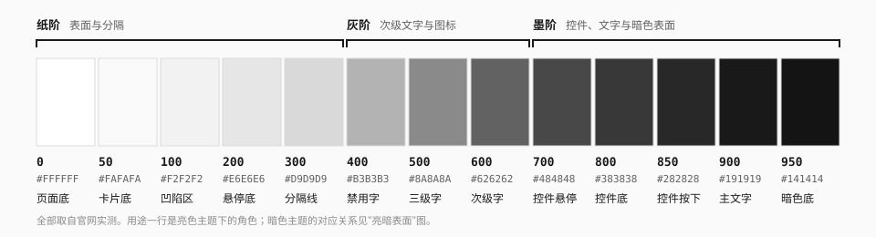
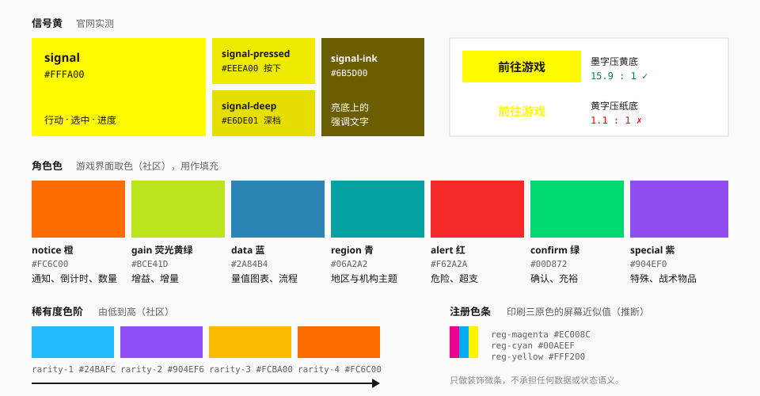
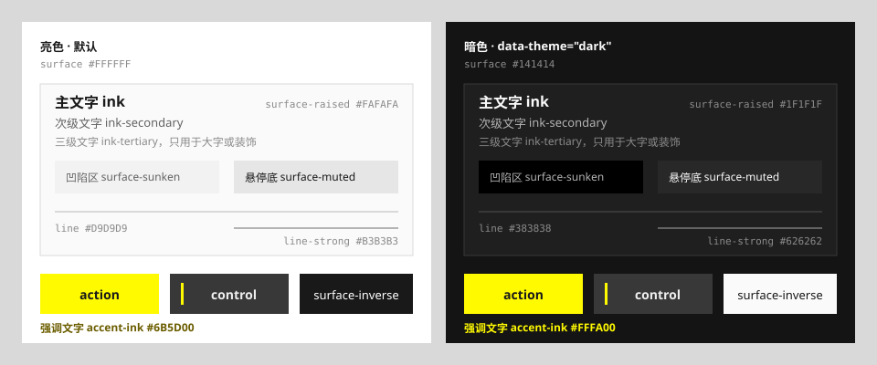

# 色彩

## 定位与原则

终末地的配色是**一套中性灰阶 + 一个信号色**，游戏界面在此之上再加一组分工明确的角色色。

1. **大面积只用中性色。** 白、浅灰、深灰、近黑构成全部的表面与文字。
2. **黄色是信号，不是装饰。** 它只标记行动、选中与进度。
3. **颜色有角色。** 橙、蓝、青、红、绿、紫各管一件事，不互相替代，也不拿来点缀。
4. **主题色可以接管，语义色不能丢。** 角色、活动、地区可以把黄换成自己的主题色，但危险仍然是红，成功仍然是绿。
5. **每个颜色都要对它实际所在的底色验算对比度。**

## 中性色阶



十三级，全部取自官网实测。官网的灰是**纯灰**（R = G = B），不带冷暖倾向。

云游戏页常用的灰也是纯灰：`#EEEEEE`、`#BFBFBF`、`#737373`、`#3A3A3A`、`#292929`、`#5E5E5E`、`#787878`、`#A7A7A7`…（实测（云游戏页））。页面里嵌的账号 SDK 弹窗换了终末地皮肤，它的浅灰带色偏：协议面板的 `#F5F6FA` 偏冷，次按钮的 `#F2F1EF`（悬停 `#FCFBF9`）偏暖（实测（账号 SDK））；这里不取，见 [云游戏页](../surfaces/cloud.md#账号-sdk-弹窗)。

| 令牌 | 值 | 亮色主题下的用途 | 来源 |
| --- | --- | --- | --- |
| `neutral-0` | `#FFFFFF` | 页面底、导航轨底 | 实测 |
| `neutral-50` | `#FAFAFA` | 卡片、弹窗、圆形翻页钮 | 实测 |
| `neutral-100` | `#F2F2F2` | 凹陷区、标签值底、图标钮底 | 实测 |
| `neutral-200` | `#E6E6E6` | 悬停底、激活底、分页条 | 实测 |
| `neutral-300` | `#D9D9D9` | 分隔线、未激活图标 | 实测 |
| `neutral-400` | `#B3B3B3` | 强分隔线、禁用文字、装饰线稿 | 实测 |
| `neutral-500` | `#8A8A8A` | 三级文字、括号 | 实测 |
| `neutral-600` | `#626262` | 次级文字 | 实测（官网用作返回按钮悬停底） |
| `neutral-700` | `#484848` | 中性控件悬停 | 实测 |
| `neutral-800` | `#383838` | 中性控件底、深色标签 | 实测 |
| `neutral-850` | `#282828` | 中性控件按下 | 实测 |
| `neutral-900` | `#191919` | 主文字、反转块 | 实测 |
| `neutral-950` | `#141414` | 标题文字、暗色页面底 | 实测 |

纯黑 `#000000` 只用于暗色主题里最深的凹陷区（官网的世界观与影像版块）。

> 官网的次级文字实际用的是 `#808080` – `#999999`，在白底上不到 4:1，达不到正文的对比度要求。本规范把次级文字定为 `neutral-600`（6.1:1），把 `neutral-500` 降为"三级"，只用于大字号或装饰性文字。这一条是**推断**。

## 信号黄



| 令牌 | 值 | 用途 | 来源 |
| --- | --- | --- | --- |
| `signal` | `#FFFA00` | 行动按钮底、当前导航项、选中环、进度填充 | 实测 |
| `signal-pressed` | `#EEEA00` | 黄色控件的按下态 | 实测（分页按钮按下） |
| `signal-deep` | `#E6DE01` | 黄底上的分隔线、更深一档的按下 | 实测 |
| `signal-ink` | `#6B5D00` | 亮色表面上"强调色作文字"时的深档 | 社区（dsh-theme-endfield） |

### 黄色只做底，不做亮底上的字

`#FFFA00` 在白底上的对比度只有 **1.11:1**，等于看不见。所以：

- 黄色作**填充**时，上面压 `neutral-900` 的墨字（15.9:1）。
- 亮色表面上需要"黄色文字"的地方，用 `signal-ink`（白底 6.6:1，`neutral-100` 上 5.9:1）。
- 暗色表面上可以直接用 `signal` 作文字（`#141414` 上 16.6:1）。

语义令牌 `accent-ink` 已经按主题切好：亮色取 `signal-ink`，暗色取 `signal`。

### 官网黄与游戏黄不是同一个值

| 出处 | 值 | 来源 |
| --- | --- | --- |
| 官网首页主黄 | `#FFFA00` | 实测 |
| 官网首页局部变体 | `#FFF500`、`#FFF000`、`#FDFD1F` | 实测 |
| 云游戏页品牌黄："更多"侧栏当前项的下划线、"下载"左缘的渐变与悬停底、进度条 | `#FFF100` | 实测（云游戏页） |
| 云游戏页按钮黄："开始游戏"胶囊的默认 / 悬停 / 按下 | `#F2E200` / `#F2E861` / `#918800` | 实测（云游戏页） |
| 云游戏页图片里的黄：角块、斜纹、标题横条 | `#FDFD1F`（另有 `#FFFA00`） | 观察（云游戏页） |
| 账号 SDK 的终末地皮肤：品牌色条与勾选框 / 链接与高亮字 | `#FFD800` / `#E9BA15` | 实测（账号 SDK） |
| 游戏内选中、进度条 | `#FCEA00` – `#FCEC00` | 社区（取色） |
| 游戏内技能树节点 | `#F7C506` | 社区（取色） |
| ReEnd 组件库 | `#FFD429` | 社区（作者取值） |
| endfield-design-skill 的"行动黄" | `#F8D34D` | 社区（作者取值） |

官网首页的黄偏冷、接近纯黄；游戏内的黄更暖、略偏金。本规范取官网首页的值作为 `signal`。如果要做贴近游戏内观感的界面，可以在项目里把 `--ef-action` 覆盖成 `#FCEA00`，其余规则不变。

云游戏页把品牌黄和按钮黄分成了两个值，账号 SDK 的终末地皮肤又是 `#FFD800`；这里仍只有一种 `signal`，不加第二种黄，见 [云游戏页](../surfaces/cloud.md#和规范不一致的地方)。SDK 的 `#E9BA15` 是压在白底和 `#F5F6FA` 浅底上的黄字，协议链接悬停时还换成 `#FFD800`、再降到 0.8 不透明，对比度很低；亮色表面上的强调字照旧用 `signal-ink`。

## 角色色

游戏界面里，黄色之外的颜色各有固定分工。以下取值来自 `endfield-design-skill` 对实机截图的取色，本仓库没有独立验证，等级为**社区**。

| 令牌 | 值 | 角色 | 不要用来 |
| --- | --- | --- | --- |
| `notice` | `#FC6C00` | 通知角标、倒计时、等级带、数量与折扣 | 表示危险 |
| `gain` | `#BCE41D` | 增益标签（`+6%`）、经验增量 | 填充进度条（进度归黄） |
| `data` | `#2A84B4` | 量值图表、流程连线 | 表示"完成了多少"（那是进度，归黄） |
| `region` | `#06A2A2` | 地区、机构的主题色 | 当通用数据色 |
| `alert` | `#F62A2A` | 危险、紧急、超支 | 当普通装饰 |
| `confirm` | `#00D872` | 确认、充裕、通用标签 | — |
| `special` | `#904EF0` | 特殊与战术物品、特定角色主题 | — |

`gain` 的社区取色范围是 `#E4FC00` – `#BCE41D`。本规范取偏绿的一端，是为了和 `signal` 拉开距离（**推断**）。

**进度与量值的区别**值得单独记：表达"完成了多少"的轨道条用黄（灰轨 + 黄填充），表达"数量有多少"的图表用蓝。

云游戏页里有几处能和上表对上，只作参照，令牌不变（实测（云游戏页），见 [云游戏页实测](../references/measurements-cloud.md) 3.1、3.5）：顶栏"公告"上的角标是提醒橙 `#FF7500`（变量名就叫"提醒"，`general-4-highlight-highlight-remind`），和 `notice` 管的是同一件事；胶囊按钮的警示变体是红 `#F14F53`（悬停 `#F76468`、按下 `#8F2426`）；另有一组状态色，绿 `#7DCB1A`、黄 `#E1BD00`、红 `#F95A5E` 给时长的增减、节点延迟和网络状态着色，蓝 `#1CB7F0` 用在移动端浏览器提示条里的链接上。

### 稀有度色阶

由低到高四档：蓝 → 紫 → 金 → 橙。

| 令牌 | 值 |
| --- | --- |
| `rarity-1` | `#24BAFC` |
| `rarity-2` | `#904EF6` |
| `rarity-3` | `#FCBA00` |
| `rarity-4` | `#FC6C00` |

用法是卡片**底部的渐变或底边条**，不是整圈描边；最高档可以在渐变上叠细斜纹。见 [卡片](../components/card.md)。

### 角色色作文字

上面的角色色是按"填充"取的，直接当文字用大多达不到对比度。需要用文字表达状态时，用按主题切好的语义令牌：

| 令牌 | 亮色 | 暗色 | 对比度（亮 / 暗） |
| --- | --- | --- | --- |
| `danger` | `#DE0909` | `#F74040` | 4.5:1 / 4.5:1 |
| `success` | `#007F43` | `#00D872` | 4.6:1 / 8.7:1 |
| `warning` | `#B74E00` | `#FC6C00` | 4.6:1 / 5.7:1 |
| `info` | `#25759F` | `#2D8FC2` | 4.5:1 / 4.6:1 |

对比度按各主题里最不利的常用表面计算：亮色是 `surface-sunken`（`#F2F2F2`），暗色是 `surface-raised`（`#1F1F1F`）。

这些值是把对应的角色色沿明度方向调到刚好达标得出的（**推断**）。状态不能只靠颜色表达，必须同时有图标或文字。

### 色块上放什么字

角色色作填充、上面要压文字时：

| 填充 | 压墨字（`neutral-900`） | 压白字 | 建议 |
| --- | --- | --- | --- |
| `notice`、`rarity-4` | 6.1:1 | 2.9:1 | 墨字 |
| `gain` | 11.9:1 | 1.5:1 | 墨字 |
| `confirm` | 9.3:1 | 1.9:1 | 墨字 |
| `region` | 5.6:1 | 3.1:1 | 墨字 |
| `rarity-1` | 8.0:1 | 2.2:1 | 墨字 |
| `rarity-3` | 10.2:1 | 1.7:1 | 墨字 |
| `special`、`rarity-2` | 3.8 – 3.9:1 | 4.6:1 | 白字 |
| `data` | 4.2:1 | 4.2:1 | 都不够：只放图标或大号粗体，或改用 `#25759F` 作底配白字（5.1:1） |
| `alert` | 4.4:1 | 4.0:1 | 都不够：只放图标或大号粗体，或改用 `#DE0909` 作底配白字（5.1:1） |

## 亮色与暗色



官网和游戏里亮、暗两套基底都存在，都算"正统"。本规范默认亮色，在根元素上加 `data-theme="dark"` 切到暗色。

`data-theme="dark"` 与 `data-theme="light"` 也可以加在局部容器上：亮色页面里嵌一个深色版块，或者反过来。还有第三个取值 `data-theme="inverse"`，意思是"和所在的主题相反"，见下面的[反转块里的局部主题](#反转块里的局部主题)。

| 语义令牌 | 亮色 | 暗色 | 用途 |
| --- | --- | --- | --- |
| `surface` | `#FFFFFF` | `#141414` | 页面底 |
| `surface-raised` | `#FAFAFA` | `#1F1F1F` | 卡片、弹窗、浮层 |
| `surface-sunken` | `#F2F2F2` | `#000000` | 凹陷区、输入框底 |
| `surface-muted` | `#E6E6E6` | `#282828` | 悬停、激活、分页条 |
| `surface-inverse` | `#191919` | `#FAFAFA` | 反转块（标签名、强调条） |
| `ink` | `#191919` | `#FAFAFA` | 主文字 |
| `ink-secondary` | `#626262` | `#B3B3B3` | 次级文字 |
| `ink-tertiary` | `#8A8A8A` | `#8A8A8A` | 大字号或装饰性文字 |
| `ink-disabled` | `#B3B3B3` | `#626262` | 禁用文字 |
| `ink-inverse` | `#FFFFFF` | `#191919` | 反转块上的文字 |
| `line` | `#D9D9D9` | `#383838` | 分隔线、描边 |
| `line-strong` | `#B3B3B3` | `#626262` | 强调分隔、输入框描边 |
| `action` | `#FFFA00` | `#FFFA00` | 行动与选中的填充 |
| `action-pressed` | `#EEEA00` | `#EEEA00` | 按下 |
| `on-action` | `#191919` | `#191919` | 黄底上的文字 |
| `accent-ink` | `#6B5D00` | `#FFFA00` | 强调文字 |
| `accent-ink-inverse` | 同 `action` | `#6B5D00` | 反转块（`surface-inverse`）上的强调记号 |
| `control` | `#383838` | `#383838` | 中性按钮底 |
| `control-hover` | `#484848` | `#484848` | 悬停 |
| `control-pressed` | `#282828` | `#282828` | 按下 |
| `on-control` | `#EEEEEE` | `#EEEEEE` | 中性按钮上的文字 |
| `button` | `#383838` | 白 20% | 按钮（`control` 变体）的底 |
| `button-hover` | `#484848` | 白 30% | 悬停 |
| `button-pressed` | `#282828` | 白 15% | 按下 |
| `on-button` | `#EEEEEE` | `#D9D9D9` | 按钮上的文字；悬停、按下时是白 |
| `disabled` | `#B3B3B3` | `#282828` | 禁用控件的填充 |
| `on-disabled` | `#626262` | `#626262` | 禁用填充上的文字与记号 |
| `focus` | `#191919` | `#FFFA00` | 焦点环 |
| `scrim` | 黑 50% | 黑 70% | 弹窗遮罩 |

亮色各值与暗色的 `#141414`、`#1F1F1F`、`#000000`、`#383838` 来自官网实测；暗色主题的其余取值是按同一套中性阶反向映射的**推断**。

中性控件（`control` 系列）在两个主题下取值相同：官网首页的深色版块里按钮仍是 `#383838`。

按钮的 `control` 变体另读 `button` 这一组：亮色就是 `control` 那几档；暗色下换成压在页面上的半透明白，照云游戏页顶栏的深色导航项（白 20%，悬停 30%，按下 15%，实测（云游戏页），见 [云游戏页实测](../references/measurements-cloud.md) 8.2）。半透明的底比下面的页面亮一档，压在哪一种暗色面上都分得出来。字取 `#D9D9D9`，比官网的 `#BFBFBF` 亮一档：压在 `surface-muted` 上时 `#BFBFBF` 只有 4.2:1，`#D9D9D9` 在 `surface`、`surface-raised`、`surface-muted` 上分别是 7.0、6.1、5.5:1（推断）。其余用 `control` 的控件（资源胶囊、步进器、排期条目、实心标签、`back` 按钮）不跟着变。

三个在实现组件时补上的令牌（**推断**）：

- **`accent-ink-inverse`**——`surface-inverse` 在亮色主题下是墨色、在暗色主题下是近白，压在它上面的强调记号（反转图标钮的图标、已选的复选框里的对勾）要跟着换档：亮色下直接用行动色，暗色下用强调色的文字档。它和 `accent-ink` 正好相反。整块的反转区域（面板标题带、表头带）后来改成了局部主题，里面直接用 `accent-ink`，见下面的"反转块里的局部主题"。
- **`disabled` / `on-disabled`**——官网的禁用按钮是 `#888888` 底配 `#666666` 字（实测）。这个底色在暗色页面上比正常的 `control` 还亮，所以禁用填充按主题取值：亮色取 `neutral-400`，暗色取 `neutral-850`；文字两边都是 `neutral-600`。

### 哪些颜色有意不随主题变

组件里随主题翻转的颜色一律走上表的语义令牌。只有"本来就是为某一种底色设计"的填充才直接用 `neutral-*`，在两个主题下保持不变：

| 位置 | 取值 | 理由 |
| --- | --- | --- |
| `light` 按钮 | `neutral-100` 底叠墨色 8% 的点阵、`neutral-900` 字；悬停 `neutral-50`，按下 `neutral-200` | 规范里它就是"用在深色底上"的浅色按钮；点阵也写成固定的墨色比例 |
| `danger` 按钮 | `alert-fill` 底（`#DE0909`，悬停 `#C40808`、按下 `#A80707`）、白字 | 暗色主题的 `danger` 是按文字调的 `#F74040`，作底配白字只有 3.6:1；固定用这一档，白字 5.1:1 起 |
| 圆形图标钮 | `neutral-50` 底、`neutral-900` 图标 | 要压在图像和深色版块上（官网的黑底版块里它仍是白的） |
| 分节标题的滑块 | `neutral-300` 底、`neutral-900` 箭头 | 官网：深色底上滑块保持浅灰 |
| `control` 系列 | 见上表 | 官网深色版块里按钮仍是 `#383838` |
| 资源胶囊 | `control` 底、`on-control` 字 | 游戏界面里它就是一颗深色胶囊；沿用 `control` 系列 |
| 增益签、通知角标 | `gain` / `notice` 底、`neutral-900` 字 | 角色色是按"填充 + 墨字"取的，见"色块上放什么字" |
| 日期块的小红角 | `alert` | 6px 的小三角，不承载文字 |
| 录制指示的红点 | `alert` | 8px 的圆点，不承载文字 |
| 警示条纹 | `signal` 与 `neutral-900` | 黄黑相间本身就是它的含义，换成别的颜色就认不出来了 |
| 注册色条 | `reg-magenta`、`reg-cyan`、`reg-yellow` | 印刷校准用的三原色，只做装饰。云游戏页分享浮层里的三色竖条是 CSS 写的 `#FE1AAB` / `#3BFFB7` / `#FEFB3C`，中间一段是薄荷绿、不是青（实测（云游戏页），见 [云游戏页](../surfaces/cloud.md#几样母题)）；`reg-cyan` 仍按印刷青取，是推断 |
| 物品格的稀有度渐变 | `rarity-1` 到 `rarity-4` | 稀有度色阶是固定的角色色，只作填充 |
| 物品格"不可用"遮罩上的字 | `neutral-0` 字、`neutral-950` 垫底 | 遮罩（`scrim`）在两个主题下都是黑的 |
| 斜纹的"中"档 | `neutral-700` | 配的是 `control` 系列的深色控件 |
| 加载页 | `neutral-950` 底、`neutral-0` 字、`neutral-800` 轨道 | 官网的加载页在浅色站点上也是近黑底；它盖住整个页面，不属于任何一个主题 |
| 开屏页 | 一块局部的暗色主题（`data-theme="dark"`）：`surface` 底、`ink` 字、`action` 的条和读数 | 同上；它有插槽（标志、底图），所以做成局部主题，放进去的东西照常用语义令牌 |
| 弹窗与抽屉的标题带 | 暗色主题的 `surface-raised`、`ink`、`line` | 官网的弹窗标题栏在浅色站点上也是 `#1F1F1F` |
| 轻提示 | `black` 80% 底、`white` 字，其余按暗色主题 | 官网首页的轻提示就是黑 80% 配白字（实测）。云游戏页的提示条、分享浮层也是黑 80%，但都加了 5px 的背景模糊，提示条还多一圈 1px 白 12% 的边（实测（云游戏页））；这里仍是实底、不模糊 |
| `strong` 的下拉面板 | 暗色主题的 `surface-raised`，当前项 `action` 底 | 官网的语言菜单是深色面板配黄色当前项（实测） |
| 展开条 | 暗色主题的 `surface-raised`、`ink-secondary`、`line`，一条 `action` 色竖条 | 官网的分享展开条是墨黑的横条配黄色竖条（实测） |
| 行带（列表的 `band` 变体、数据行带） | 暗色主题的 `surface`、`ink`、`line`；选中行反过来用亮色主题 | 游戏界面里是浅画布上的深色行，选中行白底墨字（社区） |
| 小型面积图 | `data`、`alert` | 量值图表的角色色，只作图形 |

展开条、行带和它们上面的三项做法和别的不同：它们不是逐个写 `neutral-*`，而是自己成为一个 `data-theme="dark"` 的局部主题。以标题带为例：它里面有会聚焦的关闭按钮，焦点环也得按深色底取值——整块换主题比逐个写死可靠。**一块固定深色或固定浅色的区域里还要放别的控件时，都用这个办法。**文字提示更进一步，用的是和页面"相反"的主题，见 [浮层](../components/overlay.md)。

### 反转块里的局部主题

`surface-inverse` 是"和页面相反"的一块：亮色主题下是墨色，暗色主题下是近白。面板的标题带、表格的表头带、完成横幅都是它。

问题出在这块底上**还要放别的控件**的时候。控件拿的是页面的令牌：亮色页面上，按钮的焦点环是墨色，压在墨色的标题带上看不见；已选的复选框是一个墨色方格，和带子融成一片，只剩一个对勾。逐个给它们换写法（"在反转块上用 `accent-ink-inverse`"）只管得了自己写的那几处，使用方塞进来的控件管不到。

所以反转块自己成为一个局部主题：`data-theme="inverse"`。里面照常用 `surface`、`ink`、`line`、`focus`…，取到的是按这块底色配好的值。

| 令牌 | 在反转块里取什么 |
| --- | --- |
| `surface` | 所在主题的 `surface-inverse`——这块底本身 |
| `ink` | 所在主题的 `ink-inverse` |
| `accent-ink` | 所在主题的 `accent-ink-inverse` |
| `surface-inverse` / `ink-inverse` / `accent-ink-inverse` | 所在主题的 `surface` / `ink` / `accent-ink`：反转块里的反转块就是页面的颜色 |
| 其余随主题变的令牌 | 相反主题的取值 |
| `action`、`control` 系列 | 不变：它们在两个主题下本来就相同 |
| `button` 系列 | 相反主题的取值：亮色页面上的反转块里，按钮是半透明的白 |

前三行保证了一件事：一块原来写着 `bg-surface-inverse text-ink-inverse` 的区域，改成 `data-theme="inverse"` 加 `bg-surface text-ink` 之后**颜色一点不变**，变的只是里面的东西。局部改过强调色的容器（下面的"主题色接管"）也照样带得进来。

和固定深色的局部主题（`data-theme="dark"`）的分工：

| | 用哪个 |
| --- | --- |
| 这块区域在亮、暗两个主题下都是深色（弹窗标题带、轻提示、行带） | `data-theme="dark"` |
| 这块区域跟着主题翻，但总和页面相反（面板标题带、表头带、完成横幅） | `data-theme="inverse"` |

两条限制：

- **反转块里不要再嵌反转块。** 它不会翻回页面的主题，而是和外面那层反转块相同。反转块里要一块和页面同色的区域，直接用 `bg-surface-inverse text-ink-inverse`；要里面的控件也跟着取值，写明 `data-theme="light"` 或 `"dark"`。
- 叶子上的反转填充不用它：键位提示、`inverse` 的标签、选中的胶囊、主行动块里面不再放别的控件，继续直接用 `surface-inverse`。

实现上（[theme.css](../../../packages/ui/src/styles/theme.css)）分两路：

- **底、字、强调色**这三对，由反转块的**父元素**对调着抄一份给它（选择器是 `:has(> [data-theme="inverse"])`）。绕这一下是因为 CSS 里一个元素读不到"自己正在改写的那个变量在父级是什么值"——在反转块自己身上写"`surface` 取 `surface-inverse`、`surface-inverse` 取 `surface`"，两个变量互相引用，都会失效。由父元素来抄，局部改过的强调色（主题色接管）自然也在里面。
- **其余令牌**取相反主题的值：亮、暗两块里各多写了一组 `--ef-x-*`，反转主题把 `--ef-*` 指过去。这一组是手抄的第二份，有一条单元测试核对它们和另一块逐项相同。

两路走的都是继承，所以取到的一定是**最近**那个主题的反面——亮、暗两个容器同时出现在页面上时也不会取错。现有的亮、暗两套取值没有动。`:has()` 在本库支持的浏览器范围内都可用（和 Tailwind v4 的底线相同）。

### 语义色作底

`danger`、`success`、`warning`、`info` 是按"文字"调的，但也可以反过来作底，上面压 `ink-inverse`：

| 底 | 字 | 亮色 | 暗色 |
| --- | --- | --- | --- |
| `success` | `ink-inverse` | 5.1:1 | 9.3:1 |
| `danger` | `ink-inverse` | 5.1:1 | 4.8:1 |

倒计时的"充裕"与"紧迫"用的就是这两组。角色色里的 `confirm` 与 `alert` 不适合这个位置：`alert` 作底时墨字白字都不到 4.5:1。

### 云游戏页的分层命名

云游戏页的颜色变量是另一种起名法：名字里依次写明给哪一面用（`dark`、`light`，或两面通用的 `general`）、组的序号、用途和档位（实测（云游戏页），见 [云游戏页实测](../references/measurements-cloud.md) 3.1）。

| 层 | 名字的样子 | 例子 |
| --- | --- | --- |
| 深底上的字 | `dark-1-text-primary` / `secondary` / `tertiary` / `quaternary` | `#EEEEEE` / `#BFBFBF` / `#737373` / `#3A3A3A` |
| 浅底上的字 | `light-1-text-primary` / … / `quaternary` | `#292929` / `#5E5E5E` / `#787878` / `#A7A7A7` |
| 浅色的底 | `light-2-bg-bg-2` – `bg-4` | `#D9D9D9` / `#E6E6E6` / `#F2F2F2` |
| 状态色 | `light-3-status-color-blue` / `green` / `red` / `yellow` | `#1CB7F0` / `#7DCB1A` / `#F95A5E` / `#E1BD00` |
| 品牌 | `general-1-brand-yellow` | `#FFF100` |
| 黑白的透明档 | `general-2-basic-black-mask-N`、`white-mask-N`，N 是不透明度的百分数 | 顶栏、提示条、分享浮层的底都是 `black-mask-80` |
| 按钮底色 | `general-3-btn-bg-<颜色>-default` / `hover` / `pressed` | 黄 `#F2E200` / `#F2E861` / `#918800` |
| 强调 | `general-4-highlight-*` | 提醒 `#FF7500` |

值得学的是两点：文字在深底、浅底上各分固定的四档，档名一一对应；按钮的三态写成一组，名字里就带着状态。不过页面的根上只定义了其中一部分，其余的只写在 `var()` 的回退值里，靠回退值生效。

本规范的语义令牌按用途起名（`ink-secondary`、`surface-raised`、`action`），亮暗由 `data-theme` 切换、不进名字：同一个 `ink` 在两个主题下自动换值，组件不用知道自己在哪一面。这里不改起名法，见 [云游戏页](../surfaces/cloud.md#可以学什么不必学什么)。取过来的值只有一处：按钮的 `button` / `button-hover` / `button-pressed` 三态成组，暗色下就是 `white-mask-20` / `30` / `15` 那三档白（见上面的[亮色与暗色](#亮色与暗色)）。

## 对比度

| 组合 | 对比度 | 结论 |
| --- | --- | --- |
| `ink` / `surface`（亮） | 17.6:1 | 通过 |
| `ink-secondary` / `surface`（亮） | 6.1:1 | 通过 |
| `ink-secondary` / `surface-sunken`（亮） | 5.5:1 | 通过 |
| `ink-tertiary` / `surface`（亮） | 3.5:1 | 仅限 ≥ 24px 或装饰 |
| `ink-disabled` / `surface`（亮） | 2.1:1 | 仅限禁用态 |
| `on-action` / `action` | 15.9:1 | 通过 |
| `on-action` / `action-pressed` | 13.7:1 | 通过 |
| `on-control` / `control` | 10.1:1 | 通过 |
| `on-button` / `button`（暗，压在 `surface-muted` 上） | 5.5:1 | 通过；压在 `surface` 上 7.0:1 |
| 白 / `alert-fill` | 5.1:1 | 通过；悬停 6.2:1，按下 7.8:1 |
| `accent-ink` / `surface`（亮） | 6.6:1 | 通过 |
| `signal` / `surface`（亮） | 1.1:1 | **不可用作文字** |
| `ink` / `surface`（暗） | 17.7:1 | 通过 |
| `ink-secondary` / `surface`（暗） | 8.8:1 | 通过 |
| `ink-tertiary` / `surface-raised`（暗） | 4.8:1 | 通过 |
| `accent-ink` / `surface`（暗） | 16.6:1 | 通过 |
| `accent-ink-inverse` / `surface-inverse`（亮） | 15.9:1 | 通过 |
| `accent-ink-inverse` / `surface-inverse`（暗） | 6.3:1 | 通过 |
| `on-disabled` / `disabled`（亮） | 2.9:1 | 仅限禁用态 |
| `on-disabled` / `disabled`（暗） | 2.4:1 | 仅限禁用态 |
| `action` / `line`（亮，进度条的填充对轨道） | 1.3:1 | 偏低；靠色相差区分，确切数值另用文字给出，见 [反馈](../components/feedback.md) |
| `action` / `line`（暗） | 10.6:1 | 通过 |
| `line-strong` / `surface`（亮，未选的复选框描边） | 2.1:1 | 偏低；靠凹陷底与 2px 线宽补足 |
| `line` / `surface`（亮） | 1.4:1 | 仅作分隔，不能单独表示控件边界 |

`line` 的对比度很低，这是有意的：官网的分隔线就是"刚好看得见"。但输入框这类必须看清边界的控件要用 `line-strong` 或底色区分。

## 高对比模式

系统开了高对比模式（CSS 的 `forced-colors: active`）时，浏览器把作者写的颜色换成使用者自己定的那几种系统色：字、边线各归各的系统色，**底色一律换成页面色**，阴影直接不画。亮、暗两套令牌这时候都不作数。

这套语言里的"选中"大量靠**填充反转**表示——墨底白字的一块。底色被换掉之后，选中的和没选的就成了一个样子；用底色画出来的记号（粗条、短横、圆点）和用阴影画的环也一样，整个不见了。不说状态、只是全靠底色成形的部件同样如此：滑块、进度条、加载指示、骨架整个不见，框里的值块、排期的条目只剩里面的字。

所以凡是只靠底色或阴影成形的地方——说"选中 / 当前"的也好，只是一个部件的也好——高对比模式下另写一份，用**系统色关键字**。作者显式写的系统色关键字浏览器不替换，它们跟着使用者选的那套配色走。（**推断**：对应关系是按各个系统色的本义排的；画出来的样子用浏览器的 forced-colors 模拟在亮、暗两套系统配色下逐个截图核对过，没有在真的 Windows 高对比主题下看过。）

| 平时 | 高对比模式下 | 用在哪 |
| --- | --- | --- |
| 填充反转的"选中"块：`surface-inverse` 底、`ink-inverse` 字；或 `action` 底、`on-action` 字 | `Highlight` 底、`HighlightText` 字——系统的"选中项"那一对 | 分段选择的墨块、胶囊页签与筛选胶囊、楔形页签、月历的选中格与一段的两端、工具栏按下的开关钮、激活的图标按钮、已选的复选框与单选框（菱形方案相同）、开着的开关的轨道、双标签开关的旋钮、步骤条当前的节点 |
| 压在这种块上的记号：`accent-ink-inverse` | `HighlightText` | 复选框的勾与短横、单选框的圆点、开着的开关的旋钮、工具栏开关钮的图标、压在选中格上的"今天"短线 |
| 用底色画的"当前"记号 | `Highlight` | 页内目录的粗条、下拉与菜单当前项左缘的竖条、进度短横当前的那一根、数据行带的收藏圆、时间线当前的节点、排期里"今天"的竖线（平时是强调色的边线） |
| 用阴影画的环 | 一圈 3px 的 `Highlight` 边线，画在里面 | 头像的选中环 |
| 连着的浅带（墨色 10%） | 上下各一条 2px 的 `Highlight` 线 | 月历里一段的中间 |
| 只靠底色表示的"移到了哪一项" | 一圈 2px 的 `Highlight` 环，画在里面 | 组合框的选项 |
| 只靠底色反转闪一下的提示 | 闪的那一会儿套一圈 2px 的 `Highlight` 环，画在外面 | 标签输入里重复的那个小块 |
| 选中又禁用：`disabled` 底、`on-disabled` 字 | `GrayText` 底、`Canvas` 字 | 分段选择、筛选胶囊、工具栏开关钮、开关 |
| 只靠字色说"禁用"，而这段字不在禁用的控件自己身上：`ink-disabled` | `GrayText` | 复选、单选、开关的文字标签，分段选择里没选中的禁用段，滑块禁用时的数值，多行文本和标签输入禁用时的计数，禁用的链接形态按钮，工具栏里禁用的钮 |
| 禁用的输入框里的字：`ink-disabled` 写在外框上，里面的 `<input>` 继承 | `GrayText`，写在 `<input>` 自己身上 | 输入框、组合框（多行文本、标签输入用的是同一个类，那两个系统自己也会换） |
| 靠底色围出来的一块：没了底色就只剩里面的字 | 一圈 1px 的边线，控件里的用 `ButtonText`，页面上的用 `CanvasText`；禁用的连字一起用 `GrayText` | 组合框多选和标签输入里的值块、步进器的三格、排期的条目、按钮（`text` 以外的五种变体）、没激活的图标按钮、工具栏的带子、分页条、轻提示（平时靠底色和阴影成形，系统两样都不画） |
| 为了尺寸不跳而留着占位的透明边线：系统会把它换成字色显出来 | `Canvas`——写成页面色才是真的没有 | 只读的输入框、多行文本、标签输入的外框，只读的验证码输入的每一格 |
| 占位的色块：内容还没到 | 一圈 1px 的 `GrayText` 轮廓——和输入框的占位字一个颜色 | 骨架 |
| 轨道上填了一段，两样都是底色 | 轨道剩一圈 1px 的线（空心），填上的那一段是 `Highlight` 的实心条 | 滑块的轨道和走过的一段（轨道的线是 `ButtonText`）；进度条、分段进度、不确定进度、加载页和开屏页的进度条（轨道的线是 `CanvasText`） |
| SVG 画的环：轨道和弧同样粗，只差颜色 | 轨道收成一圈 1px 的 `CanvasText` 细线，弧是 `Highlight`、线宽不变 | 进度环（含 16px 的行内加载环） |
| 两段一样粗的细线，只差颜色，细到画不出空心 | 没到的收成 1px 的 `CanvasText` 细线，走过的线宽不变 | 步骤条的连接线 |
| 图标的颜色写在它自己的 `<svg>` 上：`ink-secondary`，禁用时 `ink-disabled` | `ButtonText`；禁用时 `GrayText` | 日期选择、日期范围外框里的日历图标 |
| SVG 画的数据图形，颜色写的是令牌 | `CanvasText`，不分色调 | 小型面积图的面积和折线 |
| 不说状态、但没了底色整个部件就看不见 | 控件自己的部件用 `ButtonText`，压在页面上的记号用 `CanvasText`；禁用的用 `GrayText` | 开关关着时轨道的边线和旋钮、滑块和它的刻度、进度短横其余的几根、月历的"今天"短线、时间线已过的节点和轴、行内加载指示的方块、验证码输入分组之间的短横、步骤条已完成的节点（上面的勾用 `Canvas`）、按钮里图标和文字之间的细竖线和 `action` 的分隔线（连同加载中的旋转方块，都是 `ButtonText`；细竖线平时半透明，这里写成不透明）、工具栏的分隔线 |

规则：

- **系统色关键字只出现在 `forced-colors:` 的变体里。** 平时的颜色照旧只用令牌——这是"只用令牌"唯一的例外。
- **字压在 `Highlight` 上的那个元素，要写 `forced-color-adjust: none`。** 不写的话，浏览器会在字后面垫一块页面色的底板，把 `Highlight` 盖掉，字是 `HighlightText`、底板是页面色，读不出来。写了之后这个元素和它里面的东西不再由系统接管，所以它身上的每一处颜色——底、字、边线、焦点环——都要在 `forced-colors:` 下写成系统色。上面只有图标、没有字的（复选框、图标按钮）不用写。
- **焦点环**：画在 `Highlight` 块外面的用 `Highlight`；画在块里面的用 `HighlightText`，并且再往里收 2px（离边 4px）——贴着边的话，环和外面的页面是一个颜色，看上去只是块小了一圈。
- **禁用的字色要自己写。** 真的禁用了的按钮，系统自己会把它的字换成灰字色。但包着控件的 `<label>`、旁边的 `<output>` 和 `<span>` 上写的 `ink-disabled`，系统一律当普通字换成页面的字色，"禁用"就看不出来了。这些地方在 `forced-colors:` 下写明 `GrayText`。不是真的 `disabled` 的控件也一样：禁用的链接形态按钮是一个去掉了地址的 `<a>`，工具栏里禁用的钮还要走得到（`aria-disabled`），系统都不知道它们禁用了。**禁用的 `<input>` 也要写**：浏览器只认写了 `type` 的那些（`<textarea>` 也认），没写 `type` 的不换——输入框和组合框里的那个 `<input>` 就没写，禁用了字还是页面的字色。（推断：在 Chromium 的 forced-colors 模拟里逐个试出来的；这是浏览器自己那份样式的写法，不是规范定的，别的浏览器未必一样，所以一律自己写明。）
- **按钮的外形是一圈线，不是实心块。** 实心在这套对应里留给"选中"（`Highlight`）；主行动也不反转成实心——浏览器模拟的亮色那一套里，字色的实心块和"选中"的深紫块挨得太近。主行动靠右侧的分隔线和其余几种分开；悬停的反馈是字下面一条下划线，同样不用 `Highlight`。见 [按钮](../components/button.md#高对比模式)。
- **透明的边线也会被显形。** 系统换边线的颜色不看它是不是透明的。这有好用的一面：全靠底色成形的浮层留一圈透明的边线，高对比模式下自己就有了外形。也有反过来的：只读的输入框为了和能填的一样高，留着一条透明的底边线，这时候成了一条实打实的线——而能填的输入框底色已经没了，也只剩这一条线，两个就成了一个样。占位用的透明边线在 `forced-colors:` 下写成 `Canvas`。
- **"填了多少"用实心对空心说，不用两种系统色说。** 轨道和填上的那一段如果一个写 `CanvasText`、一个写 `Highlight`，在这两种颜色挨得近的配色下就分不开——浏览器模拟的亮色那一套就是近黑对深紫。轨道只留一圈线，填上的那一段是实心的，换哪套配色都分得出。线本身只有 2px、画不出空心的（步骤条的连接线），就用粗对细：没到的收成 1px。
- **补的是丢掉的那一层。** 工具栏里没按下的钮平时就是透明的，靠凹陷的带子围着：高对比模式下给带子补一圈线，不给每个钮补——逐个补出来是一排挨着的小方框，比平时碎得多。
- **SVG 里写的颜色系统不换。** `<svg>` 里的 `fill`、`stroke` 写的是令牌的话，高对比模式下还是主题里的那个颜色，压在使用者自己定的页面色上可能看不清。用 `currentColor` 的（图标）会跟着字色走，不用管；写了具体颜色的，在 `forced-colors:` 下另写成系统色。图标跟着走的是**继承来的**字色：颜色直接写在图标自己的 `<svg>` 上（`<CalendarIcon className="text-ink-secondary" />`）同样不换，主题里的那个灰会原样压在使用者定的页面色上——要么把颜色写在包着图标的元素上，要么另写成系统色。
- **平时已经有形状差别的不动**：加粗的当前项（侧轨、全屏菜单、列表行、面包屑）、格子页签的箭头块、表格选中行的复选框、步骤条"未到"和"有误"的空心框、时间线"未到"的空心节点，在高对比模式下本来就分得出。
- 纯装饰的整个去掉，见 [纹理](texture.md)。**说着事的线不算装饰**：和装饰画在一起、对读屏隐藏，不等于可以一起去掉——排期里"今天"的竖线就是，去掉了就没有别的地方说今天在哪。

## 主题色接管

版本、角色、地区可以有自己的主题色，把整页的强调色换掉。官网的版本日历就是例子：某个版本用红黑白，下一个版本换成冰蓝，结构不变（观察）。

实现上只需要在局部覆盖语义变量：

```css
.theme-region-wuling {
  --ef-action: #14d0d0;
  --ef-action-pressed: #10b8b8;
  --ef-accent-ink: #006a6a; /* 浅色表面上的文字档 */
  --ef-accent-ink-inverse: #14d0d0; /* 深色表面上直接用行动色 */
}

/* 暗色主题下表面的明暗反过来，两个文字档对调 */
[data-theme="dark"] .theme-region-wuling {
  --ef-accent-ink: #14d0d0;
  --ef-accent-ink-inverse: #006a6a;
}
```

规则：

- 一个界面只有一个主导主题色。
- 换的是 `action`、`action-pressed` 和两个强调文字档（`accent-ink`、`accent-ink-inverse`）；`danger`、`success`、`warning` 不动。
- 强调文字档按"所在表面是深是浅"取值，所以暗色主题下要对调，如上例。只在亮色主题下用的接管可以省掉第二段。
- 新主题色同样要过对比度：填充上压墨字 ≥ 4.5:1，文字档在所在表面上 ≥ 4.5:1。
- 主题接管时，字体、纹理也可以跟着换，不只是换色。

上例的青色取值出自 dsh-theme-endfield 的"武陵青"（社区）。

## 用法

```html
<!-- 表面与文字 -->
<section class="bg-surface text-ink">
  <p class="text-ink-secondary">次级说明</p>
  <div class="bg-surface-raised border border-line">卡片</div>
</section>

<!-- 行动：黄底墨字 -->
<button class="bg-action text-on-action active:bg-action-pressed">前往游戏</button>

<!-- 中性按钮：暗色主题下自动换成半透明的白 -->
<button
  class="rounded-sm bg-button text-on-button hover:bg-button-hover hover:text-white"
>
  更多情报
</button>

<!-- 强调文字：自动按主题取深档或原色 -->
<span class="text-accent-ink">NEW</span>

<!-- 角色色作填充 -->
<span class="bg-notice text-neutral-900">×12</span>
```

## 宜 / 忌

**宜**

- 先用中性色把层级做出来，最后再放黄色。
- 一屏只有一个黄色的主要行动。
- 用明暗反转（黑底白字的小块）做次一级的强调，把黄色留给最重要的地方。
- 状态同时用颜色 + 图标或文字。

**忌**

- 给每张卡片加黄色描边或黄色标题。
- 在白底上用黄色文字、黄色细线。
- 把 `alert` 红当装饰色，或用 `notice` 橙表示错误。
- 用彩虹色图例。图表优先用 `data` 蓝的明度变化，其次才是角色色。
- 在组件属性里出现颜色名（`color="yellow"`）。用语义名（`variant="action"`）。

## 来源

- 实测数据：[measurements.md](../references/measurements.md) 第 3 节。
- 云游戏页与账号 SDK 的颜色：[measurements-cloud.md](../references/measurements-cloud.md) 第 3 节、8.5、8.11、11.2（2026-10-24 实测）；整体面貌见 [云游戏页](../surfaces/cloud.md)。
- 颜色角色表与取色：[Statrue/endfield-design-skill](https://github.com/Statrue/endfield-design-skill)。
- 强调色在亮底下沉、对比度验算的做法：[ymh0000123/dsh-theme-endfield](https://github.com/ymh0000123/dsh-theme-endfield)。
- 令牌定义：[theme.css](../../../packages/ui/src/styles/theme.css)。
