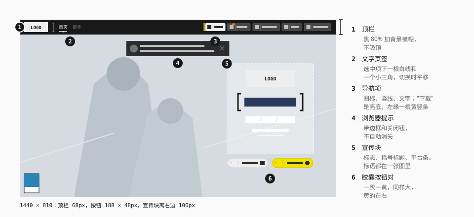
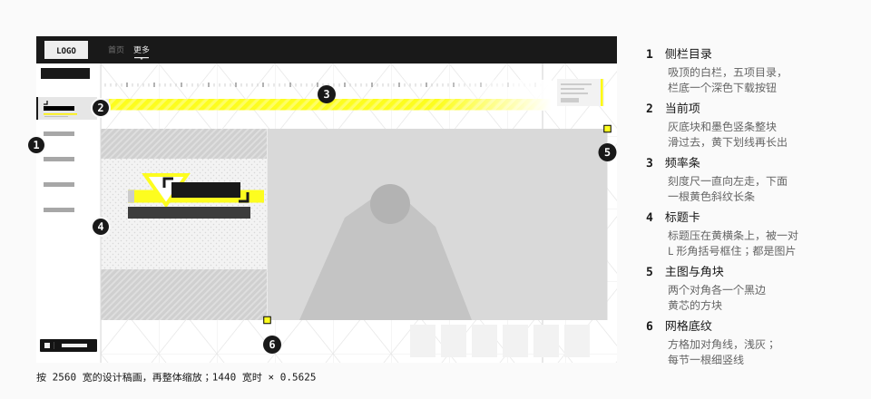
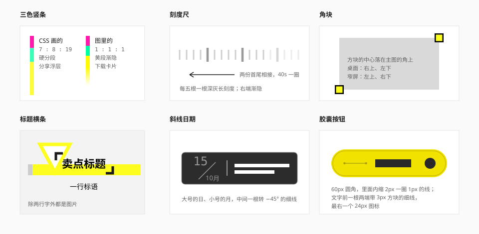

# 云游戏页

[《云·终末地》官方网站](https://endfield.hypergryph.com/cloud) 的整体面貌：在浏览器里直接玩终末地的云游戏页，挂在官网域名下，是和官网首页分开的一套构建。数值来自 [实测](../references/measurements-cloud.md)（2026-10-24）。

它和 [官网](website.md) 首页是两套东西：样式表、类名规则、根字号、字体、黄色都不一样，组件也是另写的。所以本篇单独成篇，规范里那些"官网实测"的结论仍然只指首页。本篇里凡是和规范对不上的地方，都写成"云游戏页是什么、这里取了什么"，并汇总在 [和规范不一致的地方](#和规范不一致的地方)。

页面里嵌着鹰角的通用账号弹窗，换了终末地皮肤。它是鹰角各游戏共用的组件，单独记在 [账号 SDK 弹窗](#账号-sdk-弹窗)，不拿来当终末地自己的设计依据。

## 气质

**一扇深色的窗，窗外是一张大图。** 首屏是整幅主视觉，压一条黑色的细顶栏；主行动是一对胶囊按钮。点进"更多"换成白底的卖点画册，斜纹、刻度、角标都回来了。

和官网首页对照：

| | 官网首页 | 云游戏页 |
| --- | --- | --- |
| 导航 | 左缘的白色图标轨，默认不显示文字 | 顶部一条 68px 的黑色毛玻璃条，文字页签加"图标 + 竖线 + 文字"的导航项 |
| 主要行动 | 黑底白字的"前往游戏"，悬停才变黄 | 一灰一黄两颗胶囊："下载游戏"和"开始游戏" |
| 形状 | 直角，按钮和页签有 2 – 6px 的微圆角；胶囊只给分页条、导航器和切换器 | 导航项和提示条 4px，浮层 8px，按钮组件一律是胶囊 |
| 黄 | `#FFFA00` 一种 | 品牌黄 `#FFF100`（选中、悬停、进度）和按钮黄 `#F2E200`（开始游戏）两种 |
| 浮层 | 不模糊，阴影零偏移 | 顶栏、提示条、遮罩、浮层大多是 5px 的背景模糊（桌面上采购中心的遮罩例外）；浮层的阴影向下偏 |
| 字体 | 自托管、改了名的中文字体，推断是 HarmonyOS Sans SC；英文是 Novecento、Gilroy | 自有的 CloudGame 三个字重；大标题用 HarmonyOS Sans SC Black（字族名直接写着）；标语用思源黑体；数字用 Bebas Neue |
| 尺寸 | 整页按视口宽缩放的 `rem`（1920 稿 1rem = 12px） | 桌面上 1180 – 2560px 宽固定 1rem = 16px，不缩放；窄于 1180 或宽于 2560 才按宽度缩放 |

相同的地方更多：中性外壳不随主视觉变色，深浅灰都是纯灰；装饰是印刷语气的斜纹、刻度、方块；侧栏的当前项是一块整块滑动的浅灰底配一根墨色竖条——和官网导航轨的当前项是同一个做法。

## 骨架

| 部件 | 说明 |
| --- | --- |
| 顶栏 | 通宽，68px，黑 80% 加 5px 背景模糊；不吸顶，跟着页面滚走 |
| 主舞台 | 一屏高的整幅主视觉，`cover` 居中，没有遮罩和渐变；页面底色是 `#849AAC` 的蓝灰（推断：图出来之前垫着，免得闪白） |
| 宣传块 | 主视觉右侧，竖直居中：标志、`[正式上线]`、平台条、标语（**全在一张图里**），下面一对胶囊按钮 |
| 适龄角标 | 左下角，68 × 87.5px |
| 页脚 | 首屏以下，深灰底（`#252726`），鹰角统一的备案与协议信息 |

窄屏（移动平台）是另一套排版：顶栏 3rem、只有页签，导航项换成 2.75rem 的图标钮（图片，没有文字）；标志挪到顶栏下面；宣传块贴底，按钮缩到 2.5rem 高。

### 顶栏

自左向右：

1. **标志**，108 × 44px；
2. **竖分隔**，一根两端带小方块的灰色细线（4 × 36px 的图）；
3. **文字页签**"首页 / 更多"：CloudGame Medium 18px，未选 `#737373`、悬停 `#BFBFBF`、选中 `#EEEEEE`。选中项下面一根和文字等宽的 2px 白线，线下居中一个朝下的 6 × 3px 小三角；换页签时这一组整体平移 0.2s；
4. 右侧的 **导航项**：下载、公告、问题反馈、分享、用户中心。每项是"20px 图标 + 1 × 14px 竖线 + 16px 文字"，4px 圆角，白 20% 的底，悬停到 30%、按下 15%，文字 `#BFBFBF` → 悬停白色，过渡 0.15s。

"下载"是唯一的亮色项：`#EEEEEE` 底叠一张浅灰细斜纹，文字墨色；左边隔 3px 有一根 4 × 36px 的竖条，从上往下由品牌黄渐变到白。悬停时整块变品牌黄。"公告"的图标右上角压一个橙色菱形角标（`#FF7500` 的 10px 方块转 45°，带一圈 2px 的黑色投影），和规范里的 [通知角标](../components/data-display.md#胶囊与角标) 是同一个样子。

规格见 [实测](../references/measurements-cloud.md) 8.1、8.2。

## 视图

### 首页

- **主视觉**占满首屏，宣传块放在右侧、离右边 100px。外壳（顶栏、提示条、角标）不随画面变色。
- **宣传文字全在图里**：`[正式上线]` 的方括号、平台条（网页版 / 安卓端 / iOS端，之间是浅灰斜杠，右上角一组黄、青、粉的小色块）、标语和英文微标都烧在一张 756 × 783 的图里，读屏读不到，也换不了语言。
- **一对胶囊按钮**，各 188 × 48px，间距 16px：
  - 左"下载游戏"：`#EEEEEE` 底，悬停 `#FAFAFA`，按下 `#8F8F8F`；
  - 右"开始游戏"：`#F2E200` 底，悬停 `#F2E861`，按下 `#918800`；
  - 两颗的文字都是 `#292929`、CloudGame Medium 18px。按钮里先是一根两端带 3px 小方块的细线，再是文字，最右一个 24px 图标；里面再描一圈 1px 的黑 20% 内线（内缩 2px），右侧压一张浅色等高线纹理。状态之间瞬切，没有过渡，也没有阴影。
- **浏览器提示**：顶部居中、离顶 96px 的一条 470px 宽的深色条——黑 80%、5px 背景模糊、1px 白 12% 的边、4px 圆角、`0 6px 18px` 的阴影；左边 40px 的浏览器图标，两行 16px 的 `#BFBFBF` 文字，右边 24px 的关闭钮。它不自动消失，关掉之后刷新又会出现。

这组胶囊按钮背后是一个完整的按钮组件：七种变体（主要黄、次要灰、深色、警示红、浅色描边、灰色描边、弱警示）和 24 / 28 / 34 / 40 / 44px 五档高度，见实测 8.3。登录后账号卡上的"续期""充值""开始游戏"也是它。

### 更多

点顶栏的"更多"，整页换成白底的卖点介绍。

整块按 2560px 宽的设计稿画，再按视口宽度整体缩放（1440 宽时缩到 0.5625）。五节卖点（一键体验、解放性能、顶级画质、流畅操作、节省空间）在一条普通的纵向长页里叠着排，相邻两节互相压 260 设计 px；没有整屏翻页，也没有劫持滚轮。

| 元素 | 做法 |
| --- | --- |
| 侧栏 | 左侧 284 设计 px 宽的白色栏，吸顶，`0 0 16px` 的黑 20% 环境阴影。上面一个黑色的标志 |
| 目录 | 每项 100 设计 px 高：左上一个 20px 的 ↘ 箭头，下面 CloudGame Bold 32px 的名称，未选 `#A7A7A7`、选中黑色。选中项右下角浮出一个 80px 的序号（`01` – `05`），黑色只有 3% 不透明，几乎看不见 |
| 当前项 | 一块 `#E6E6E6` 的底块，左缘一根 8 设计 px 的 `#191919` 竖条，换项时整块上下滑（0.16s 匀速）；同时一根 148 × 6 的品牌黄下划线从左往右长出来（0.24s），下面跟一行 `#BFBFBF` 的微缩字 |
| 侧栏底部 | "下载游戏"：`#141414` 底、`#EEEEEE` 字、2px 圆角，图标和文字之间一根白 30% 的竖线；悬停瞬间变成品牌黄底、黑字黑线 |
| 标题卡 | 一张灰斜纹镶边、中间是错位点阵的浅灰卡片；标题（HarmonyOS Sans SC Black 80px）压在一根黄横条上，横条上方一个黄描边的倒三角，标题被左上、右下一对 L 形角括号框住，标语在括号下面，用思源黑体 60px。**除标题和标语两行字外全是图片** |
| 主图 | 1500 × 844 设计 px 的图或视频，右上、左下两个角各压一个黑边黄芯的方块（30px，黄芯 22px）；第 2、4 节左右镜像 |
| 频率条 | 每节顶上一组：一根刻度尺（每五根一根深灰长刻度），40 秒一圈无缝向左走；下面一根黄色 45° 斜纹长条，尾端渐隐；端头一块灰色微缩字配一根黄竖条 |
| 背景 | 一张整页的网格图：约 190 × 239 设计 px 的格子（图被纵向拉长了），每格两条对角线，线是 10% – 27% 不透明的浅灰；每节一根细竖线（第 1、3、5 节在右侧 87.3% 处，第 2、4 节在左侧 12.8% 处）；主图下方一排浅灰的块状大字 |

入场：每节的元素一露出就播一次（标题卡和主图要露出 20%），不重播——斜纹和刻度"闪三下"亮起（8 段的不透明度关键帧），主图从一边擦出（0.25s），标题和标语上移 30px 淡入（0.4s / 0.35s，`cubic-bezier(.2, 0, .1, 1)`），大字从右滑入（1.5s）。减少动态效果时全部跳到终态。

每次进入"更多"先盖一层加载：近黑底、模糊的背景图，左缘一根品牌黄进度条从上往下长，百分比跟着走，下面一行 `Updating...`；偏右是标志和标语 `OVER THE FRONTIER / INTO THE FRONT`。走满后黄色从左铺满（1s）、整层淡出（1s）。这和 [官网的加载页](website.md#加载页) 是同一个设计，只是时长、曲线和标志不同。

窄屏是另一套：五节排成竖向的五张卡，每张一个主图（左上、右下两个角块）加一根黄色标题横幅，标题和标语同一行。

### 下载弹窗

点"下载"打开。

- 遮罩黑 50% 加 5px 模糊。面板按 1736 × 856 设计 px 画，桌面上一般缩到视口宽的约 68%，屏幕矮的时候再缩小。
- **头带、标题（`ENDFIELD` 字标 + "游戏下载"）、条码竖纹、底纹和面板外缘的一圈淡白光都在背景图里**，没有 CSS 的标题栏。关闭钮是一个灰色的实心 X，没有悬停态。
- 两张卡并排："游戏客户端下载""云·终末地下载"。白卡的左上缘一根三段的竖条（品红 `#FF1AAC` → 薄荷绿 `#00FFA2` → 黄 `#FFFA00`，各 24 设计 px，黄色一段往下渐隐），标题前垫一个 20px 的黄方块，标题和副标题之间一条灰色虚线，卡底一条灰斜纹——这些也都在卡片背景图里。
- 卡内：左边二维码，外框左侧一根深灰竖条写着竖排的"扫码下载"，四角各一个白色小方块；右边一列 `#333333` 底、4 设计 px 圆角的平台按钮，没有悬停态。
- 进出场：遮罩淡入，面板从右 40px 淡入，0.16s；退场反向，160ms 后卸载。

### 分享浮层

点"分享"在按钮下方展开，424px 宽。

- 黑 80% 加 5px 模糊，8px 圆角，`0 4px 16px` 的黑 20% 阴影；没有箭头、没有进出场动画。
- 头部 60px：左缘一根 2 × 34px 的三色竖条，这里是 **CSS 画的**——品红 `#FE1AAB` 7px、薄荷绿 `#3BFFB7` 8px、黄 `#FEFB3C` 19px 硬分段；标题"分享链接"CloudGame Bold 18px；背后叠一张网格图、一张倾斜 15° 的等高线图（15% 不透明）和右侧一个标记图。
- 内容区 `#F2F2F2`：左边二维码，二维码左侧一根 `#101010` 竖签，竖排"手机扫码畅玩·分享"（`writing-mode: vertical-rl`）；右边三颗 180 × 40px 的白色按钮（2px 圆角，`#787878` 字）。悬停时一块 `#444444` 从左往右铺满按钮（0.3s），字变白。
- 点"收藏页面"弹一个通用确认框：`#444444` 的 44px 头、`#E6E6E6` 的身体、4px 圆角，键帽画成两层描边的小方块，按钮是 60px 圆角的深色胶囊。

### 公告面板

点"公告"打开一个全屏的内嵌页面，地址是 `ef-webview.hypergryph.com`——这是游戏内公告用的那套网页，和本页不是一份样式表，它的样子更接近 [游戏界面](game-ui.md)。

- 外层黑 50% 加 5px 模糊；底部先是一条加载条（高 20%、黑 70%，中间一个白色标志和一个每 0.25s 跳转 90° 的倒三角），加载完成后用 0.5s 滑出，面板再淡入。
- 面板 1302 × 675px（1440 宽），7.5px 圆角。头带是一张带斜线纹的浅灰图；两个页签（上角微圆、下摆向两侧张开）的外形、选中项的箭头形白卡、`NEW` 角标、圆形关闭钮**都是图片**，没有 `clip-path`。
- 页签右上角一个橙色圆点，外面一圈橙色菱形描边每秒放大淡出一次。
- 列表项的日期写成"15 ╱ 10月"：大号的日、小号的月，中间一根旋转 −45° 的 1.5px 细线（CSS 画的），右边一根竖分隔，再是标题。
- 正文区是半透明的灰色渐变底，标题条是 `#313131` 叠一张噪点渐变图、整条 80% 不透明；小标题写成"▼//推荐配置及存储"。

### 加载页

首次进入时盖一层近黑（`#171717`）的底和背景图，中间一个灰色标志做 2s 的呼吸（不透明度 1 → 0.4 → 1）。它没有进度，一直显示到登录状态确认完——实测 1 秒到 57 秒都有。超过 30s 卡在某一步，底部会弹一条"页面启动未完成"的提示和"重新加载"按钮。

进入游戏前的云端加载、公告的加载条见上面两节；"更多"的加载层见 [更多](#更多)。

### 登录后的页面

登录之后，首屏右侧的宣传块换成一张账号卡，顶栏的"用户中心"变成一个下拉菜单。这些页面只记了结构和样式，没有记任何账号信息。

- **账号卡**：400px 宽，从主舞台底边滑到竖直居中（0.2s）。自上而下：
  - 一条活动横幅，6px 圆角；
  - 通行证卡：浅灰的头部（头像、"通行证UID"，墨色 18px 字），下面接一块黑 80% 加 5px 模糊、1px 白 20% 细边的畅玩卡块，状态 `#EEEEEE`，剩余时间用品牌黄，行尾一颗灰胶囊"续期"；
  - 时长块：同样的深色底，4px 圆角，付费时长、免费时长两行，数值是品牌黄，两行之间一根两端带小方块的细线（和胶囊按钮里那根是同一种画法），付费那一行尾是一颗 `#444444` 的深色胶囊"充值"；"续期""充值"都是 34px 高的那一档；
  - 最下面一颗 400 × 48px 的黄胶囊"开始游戏"。
- **用户中心下拉**：200px 宽，近黑 90%（`rgba(18, 18, 18, .9)`）加 5px 模糊、8px 圆角、`0 4px 16px` 的黑 40% 阴影，从上往下滑入 8px（0.2s）。五项各 36px 高：图标、16px 文字、右端一个小箭头；悬停时底变白 5%，字从 `#737373` 变成 `#BFBFBF`。
- **通用弹窗**（"消费记录查询"打开的时长记录、"功能设置"）：遮罩黑 60% 加模糊；主体黑 80%、4px 圆角，52px 的头里是居中的 18px 标题，下面一根白 10% 的细线；从右 40px 淡入，0.16s。
  - 时长记录：头部底图的下沿是一根三色细线（绿、黄、品红，长度约 6 : 3 : 1）；选中的页签是 `#F2F2F2` 的浅底，和下面浅灰的内容区连成一片。记录行 `#F2F2F2`、4px 圆角、`0 0 12px` 的黑 20% 阴影；增加的数额是绿色 `#7DCB1A`，扣减是红色 `#F95A5E`。
  - 功能设置只有一项"使用推荐的服务器节点"。开关是一颗"开 / 关"分段式的胶囊，滑块走 0.3s。
- **采购中心**："续期""充值"打开的是同一个商城。
  - 920 × 448px 的面板，8px 圆角：上面 60px 是 `#212121` 的头，下面是 `#D9D9D9`；从右 40px 淡入，0.16s。
  - 头部左边标题"//云·采购中心"；右边两枚钱包胶囊（白 10% 的底、16px 圆角）和一个白色的圆形关闭钮。
  - 左边 116px 宽的侧栏是一张底图，当前页签换成深色底图，左缘一根 6 × 48px 的黄 → 米白渐变竖条，和顶栏"下载"左边那根是一个路数。
  - 右边上面一条 768 × 143px 的横幅，下面一排横向拖动的商品卡（160 × 209px）：4px 圆角的白卡带 `0 0 12px` 的环境阴影，卡底右侧压一块白色价格牌，卡下面一条 `#292929` 的名称条；左上角向左探出 4px 的标签，赠送是 `#FFF200`、限时是 `#FC5410`。售罄的卡盖一层黑 80%。
  - **点卡片本身就是下单**，没有选中态，所以没有点。
- **收银台**：下单后弹出的是鹰角的支付组件，它专门有一套"云·终末地"皮肤：主按钮 `#262626` 的胶囊、次按钮 `#F2F1EF`，里面一样有那圈 `#9F9EA0` 的内圈线，默认色和账号弹窗的终末地皮肤相同，只是主按钮悬停是 `#3A3A3A`（账号弹窗是 `#484848`）。只读了样式规则——打开就是真的下单。
- **排队、节点选择和游戏里**：点"开始游戏"会真的发起一次云游戏会话，所以这一组只按样式表规则和脚本还原，没有看到实物。
  - 排队面板 460px 宽：`#202020` 的头配几块角饰，标题"排队中"；下面是 `#E6E6E6` 的内容区，一张等待时间卡，一条快速队列的横幅（"最高可提速95%"用品牌黄），底部一颗深色胶囊"退出排队"。有活动图时面板展开到 920px（0.8s），左边多出一栏活动图，图从左往右刷出来。
  - 最小化后是一条 36px 高的深色小条（4px 圆角）：黑 80% 加模糊，里面一个 18 秒一圈的时钟动画，可以拖，松手吸到最近的一边。
  - 节点列表按延迟给行着色。游戏里有一个悬浮球和菜单、一条跑马灯公告、三层提示。

规格见实测第 9 节。

## 几样母题

- **三色竖条**：品红、薄荷绿、黄三段，贴在标题栏或卡片的左上缘。分享浮层里是 CSS 画的硬分段（7 : 8 : 19），下载卡片里是图（三段等长，黄段往下渐隐）；时长记录弹窗的头部下沿是同一组颜色横着排的细线。和官网的注册色条是一家，见 [斜纹与色条](../elements/stripes-and-strips.md)。
- **刻度尺**：浅灰短刻度，每五根一根深灰长刻度，两份首尾相接一直向左走。见 [测绘叠层](../elements/hud-overlays.md)。
- **角块**：主图两个对角各一个黑边黄芯的小方块，方块中心落在角上。见 [括号与标记](../elements/brackets-and-markers.md)。
- **标题横条**：标题压在一根黄横条上，上方一个黄描边的倒三角，再用一对 L 形角括号框住。
- **斜线日期**：大号的日、小号的月，中间一根转 −45° 的细线。
- **胶囊按钮**：里面内缩一圈细线，文字前一根两端带小方块的细线。

## 页脚

鹰角统一的页脚，来自它的网页 SDK，用的是固定 px，不随根字号缩放：`#252726` 底，左边鹰角标志，右边一列——白色 15px 的协议链接（之间一根 1 × 14px 的白竖线）、`#8A8A8A` 12px 的备案表、反诈提示、一条 `#585858` 的横线、公司与版权、举报链接、适龄提示。窄于 720px 或竖屏时整列居中、分隔线去掉。

## 账号 SDK 弹窗

登录、快速登录、协议更新、实名、防沉迷、设备验证这些弹窗，来自鹰角各游戏共用的账号组件（账号 SDK 3.5.0）。官网首页和云游戏页加载的是同一个文件，里面写着三套皮肤：

| 皮肤 | 品牌色 | 谁在用 |
| --- | --- | --- |
| 默认 | `#CBFF40`，暗底 | 3.5.0 里已经选不到：不指定或指定了别的，都退回方舟 |
| 方舟（`ak`） | `#0098DC` | 官网首页：调登录框时不指定皮肤，出来的就是这一套 |
| 终末地（`ef`） | `#FFD800` | 云游戏页：每次弹框之前一刻把皮肤设成 `ef` |

**它不是终末地自己的设计。** 圆角卡片、胶囊输入框、圆形勾选框都是这个通用组件的形状，换皮肤只换颜色和头部的几张图。本规范不拿它推翻"直角为主"，下面只记云游戏页上看到的终末地皮肤长什么样。

终末地皮肤（1440 宽；SDK 有自己的字号基准，600 – 1917px 宽时是 12.8px，下文的数是按它算好的）：

| 部位 | 做法 |
| --- | --- |
| 卡片 | 白底，16px 圆角（1920 宽时 20px，窄于 600px 时 12px）；登录层 480 宽，确认层 640 宽。阴影是零偏移的 `0 0 19.2px` 黑 50%——皮肤里另写了一条向下偏的轻阴影，但选择器没对上，实际不生效 |
| 头 | 72px，`#262626` 叠一张很淡的白色纹理图；登录层的头正中是白色的鹰角标志（观察），确认层的头上是标题；下沿一根 4px 的 `#FFD800` 色条。关闭钮是一个 `#CCCCCA` 的叉，没有底，悬停变白 |
| 卡底装饰 | 左上、右下两张浅灰（`#EDEDED`）的线纹图，压在内容下面 |
| 主按钮 | `#262626` 的胶囊，悬停 `#484848`，禁用 `#B4B4B4`（字仍是白的）；里面内缩 2.4px 一圈 1.2px 的 `#9F9EA0` 线——和云游戏页自己的胶囊按钮是同一种内圈线 |
| 次按钮 | `#F2F1EF` 底、`#4D4D4D` 字，悬停 `#FCFBF9` |
| 输入框 | 白底胶囊，1.2px 的 `#EEEEEE` 内描边；悬停和聚焦换成 1.6px 的 `#262626`，出错 `#F96F68`；左边一个灰色图标，"发送验证码"前一根短竖线 |
| 协议勾选 | 一块 `#F5F6FA` 的浅底（6.4px 圆角）里，一个 16px 的圆形勾选框，勾上是黄底深色勾；协议链接 `#E9BA15` |
| 确认层 | 标题白字 19.2px，正文 `#4D4D4D` 16px；底部两颗按钮，次在左、主在右 |
| 设备验证 | 六个 38.4 × 48px 的格子，3.84px 圆角，`#EEEEEE` 的细内描边，当前格换成 `#262626`，光标每秒一闪（只读了规则：这一层一打开就会发短信，没有打开） |
| 进出场 | 遮罩黑 40% 淡入 0.3s，弹层再淡入 0.3s，不缩放、不位移；窄于 600px 时变成贴底的抽屉，通宽、上两角圆，从下方滑上来，0.3s |

和这套规范的关系：

- 颜色上有两处巧合：主按钮悬停的 `#484848` 就是本库的 `control-hover`；次按钮的 `#F2F1EF` / `#4D4D4D` 和 Game 入口 [圆角控件](../game/rounded-controls.md) 的默认底色、文字色相同。只记"相同"，不推因果。
- 形状一样都不取。本库的输入框、勾选框、弹窗照旧是直角和方形，见 [表单](../components/form.md)、[浮层](../components/overlay.md)。
- 设备验证的"一格一位、六格、闪烁光标"是 [验证码输入](../components/form.md) 在官方页面上的一个实例，格子的形状仍是本库自己的。

## 和规范不一致的地方

| 主题 | 规范 | 云游戏页 | 这里取了什么 |
| --- | --- | --- | --- |
| 按钮形状 | 4px 微圆角，图标和文字之间一条细竖线（[按钮](../components/button.md)） | 按钮组件一律是胶囊（60px 圆角），五档高度；顶栏右侧的导航项是 4px、"图标 + 竖线 + 文字" | 胶囊不取，取的是导航项：库里的按钮一族照它改成了 4px 圆角和细竖线，悬停只换色。做游戏风格界面时可以把行动按钮换成胶囊，规范早有这条，现在多了一个官网上的例子 |
| 主要行动的颜色 | 一屏只有一个黄色按钮；官网首页的主行动是墨黑 | 首屏的主行动就是黄胶囊"开始游戏"，旁边一颗灰胶囊；"更多"里的下载是墨底，悬停变黄 | 不变。两种都守着"一屏只有一个黄色按钮" |
| 一白一黄的按钮对 | 来自游戏内的抽取界面（社区） | 首屏就是一灰一黄并排，同等大小 | 证据升级为"实测（云游戏页）"，用法不变：只给两个同等重要的核心行动 |
| 顶部导航 | 不用居中的顶栏配下划线（[导航](../components/navigation.md)） | 靠左：标志、竖分隔、两个文字页签，选中项一根和字等宽的白线加一个小三角，换页签时滑 0.2s | 规范忌的是"居中"。靠左的文字页签加下划线记作一种做法，库里的页签不加下划线的变体 |
| 背景模糊 | 遮罩不模糊，毛玻璃列在忌里（[浮层](../components/overlay.md)） | 顶栏、提示条、遮罩、浮层大多是 5px（桌面上采购中心的遮罩不模糊）；华为、荣耀、鸿蒙的浏览器上关掉模糊，顶栏换成 `#1A1A1A` 实底 | 模糊不取，库里没有毛玻璃。半透明只取了一处：暗色主题下 `control` 按钮的底是白 20%（悬停 30%、按下 15%），照的是顶栏的深色导航项，不带模糊；其余半透明的层仍是实底 |
| 浮层圆角与阴影 | 直角，阴影零偏移（[形状](../foundations/shape.md)） | 浮层 8px 圆角、`0 4px 16px` 向下的阴影；提示条和导航项 4px | 浮层和提示条不取，仍是直角、零偏移；导航项的 4px 给了按钮一族 |
| 常驻的提示 | 轻提示没有边框、图标和关闭钮（[反馈](../components/feedback.md)） | 浏览器提示带 1px 的边、图标和关闭钮，不会自己消失 | 它是"提示条"那一类常驻提示，不是轻提示；轻提示的规范不变 |
| 黄色 | 只有一种信号黄 | 品牌黄 `#FFF100` 和略暗一点的按钮黄 `#F2E200` 分开用；图片里的黄又是 `#FDFD1F` / `#FFFA00` | 不加第二种黄 |
| 账号弹窗的形状 | 方形复选框、直角输入框、直角弹窗 | 圆形复选框、胶囊输入框、16px 圆角的卡片（1920 宽时 20px） | 不取。那是鹰角通用组件的形状，见 [账号 SDK 弹窗](#账号-sdk-弹窗) |

## 可以学什么，不必学什么

| 值得学 | 不必照搬 |
| --- | --- |
| 一套分层命名的颜色令牌：`dark-1-text-*`、`light-2-bg-*`、`general-3-btn-*`，名字里写清了明暗面、层级和用途 | 宣传文字烧进一张图：读屏读不到，换不了语言，也没法单独改 |
| 一个按钮组件管住全站：七种变体 × 五档高度，悬停和按下各有一个确定的色值 | 过渡不统一：导航项的颜色变化有 0.15s 的过渡，胶囊按钮和顶栏页签却是瞬切 |
| 当前项是一整块滑动的底块配一根竖条，换项时底块滑过去、下划线再长出来 | 只认鼠标的控件：适龄角标、导航项（除"分享"外）不能用键盘聚焦 |
| 装饰（斜纹、刻度、角标、三色条）做成图片，文字留在 DOM 里——标题和标语都还是字 | 窄于 1180px 时整页等比缩小：1024 宽时导航文字只有 8.5px |
| 照顾"减少动态效果"：18 条规则，入场动画全部跳到终态，滚动也不再平滑 | 关掉的提示刷新又出现：关闭状态没有存下来 |
| 背景模糊有降级：华为、荣耀、鸿蒙的浏览器上整页关掉模糊，半透明底换成实底 | |

## 做一个"云游戏页气质"的页面

1. 首屏放一张整幅主视觉，页面底色取画面边缘的颜色。
2. 顶上压一条黑 80% 的细栏：左边标志、竖分隔、两三个文字页签；右边"图标 + 竖线 + 文字"的小块，最重要的一项用亮底。
3. 主行动放在画面一侧、竖直居中：一对同样大的按钮，一灰一黄，黄的在右。
4. 介绍页换成白底：左边一条竖向目录，当前项用一块整块滑动的灰底和一根墨色竖条；右边每节一张大图，配一根黄斜纹、一根刻度尺、两个角上的方块。
5. 装饰用图，文字留在页面里。
6. 浮层用黑 80% 的实底；库里没有毛玻璃。

## 来源

- 全部数值：[measurements-cloud.md](../references/measurements-cloud.md)。
- 页面入口与各视图怎么进：[official-sources.md](../references/official-sources.md)。
- 和官网首页的对照：[website.md](website.md)、[measurements.md](../references/measurements.md)。
